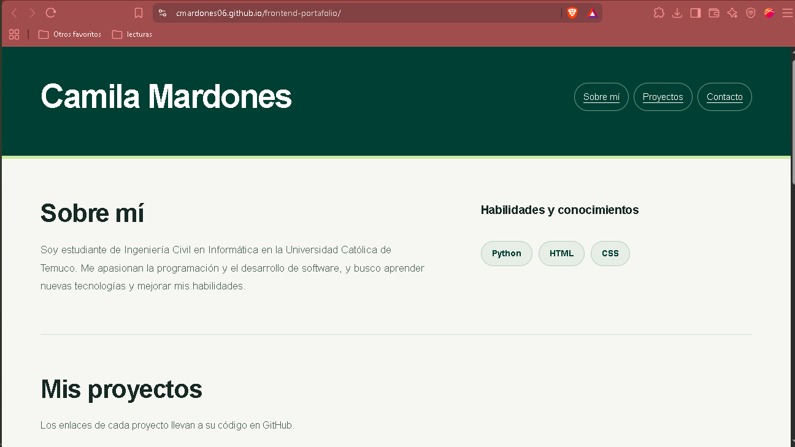

# Portafolio de Camila Mardones — Evaluación 4

Proyecto individual de Desarrollo de Frontend, ICINF1107,
Universidad Católica de Temuco.

Migración de mi portafolio de la Evaluación 2 a una aplicación
React con TypeScript, navegación mediante React Router y consumo
de GitHub REST API.

## Referencia de la Evaluación 2

- Repositorio original:
  https://github.com/CMardones06/frontend-portafolio
- Captura de referencia:



Se conservaron la identidad verde, la tipografía Arial, el fondo
claro, las tarjetas de proyectos y los contenidos principales.

La navegación por anclas se reemplazó por rutas. Se incorporaron
habilidades agrupadas, formación, objetivos, repositorios recientes
y un tema oscuro opcional. El tema claro conserva la referencia
visual del proyecto anterior.

## Tecnologías

- React y TypeScript.
- Vite.
- React Router.
- CSS con nomenclatura BEM.
- GitHub REST API.
- ESLint.

## Instalación y ejecución

Entorno utilizado: Node.js 24 y npm 11.

```bash
git clone https://github.com/CMardones06/evaluacion_4-Camila_Mardones.git
cd evaluacion_4-Camila_Mardones
npm install
npm run dev
```

Abrir la dirección que indique Vite en la terminal.
Si el puerto 5173 está ocupado, Vite puede utilizar otro.

## Verificación y compilación

```bash
npm run lint
npm run build
npm run preview
```

- `lint`: revisa el código mediante ESLint.
- `build`: comprueba TypeScript y genera la aplicación en `dist/`.
- `preview`: permite revisar localmente la compilación de producción.

`node_modules/` y `dist/` están excluidos del repositorio.

## Rutas

| Ruta | Contenido |
|---|---|
| `/` | Vista completa del portafolio. |
| `/sobre-mi` | Presentación, habilidades, formación y objetivos. |
| `/proyectos` | Proyectos destacados y repositorios recientes. |
| `/contacto` | Datos de contacto y formulario. |
| Cualquier otra ruta | Página 404 con regreso al inicio. |

Se utilizan BrowserRouter, Routes, Route, NavLink y Link.
El menú identifica la ruta activa.

Al cambiar de ruta se actualiza el título del documento y el foco
se dirige al contenido principal.

Para publicar la aplicación, el alojamiento debe permitir servir
`index.html` al visitar directamente las rutas de la SPA.
`npm run preview` es una previsualización local, no un despliegue.

## Organización del código

- `src/components/`: elementos de interfaz reutilizables.
- `src/pages/`: vistas del portafolio.
- `src/data/`: información estática y configuración.
- `src/types/`: interfaces y tipos exportados.
- `src/services/`: comunicación con GitHub y caché.
- `src/hooks/`: lógica de consulta y acceso al contexto del tema.
- `src/context/`: contexto y proveedor del tema.
- `src/assets/img/`: imágenes de los proyectos originales.
- `src/index.css`: estilos generales, componentes y temas.

## GitHub REST API

### Propósito

Mostrar proyectos reales de mi cuenta de GitHub y complementar
los tres proyectos destacados recuperados de la Evaluación 2.

### Contrato

- Método: GET.
- URL base: `https://api.github.com`.
- Endpoint: `/users/CMardones06/repos`.
- Parámetros: `sort=updated` y `per_page=6`.
- Autenticación: no se utiliza token; se consultan datos públicos.

URL completa:

```text
https://api.github.com/users/CMardones06/repos?sort=updated&per_page=6
```

La respuesta esperada es un arreglo de repositorios. Cada elemento
utilizado por la aplicación contiene:

| Campo | Tipo | Uso |
|---|---|---|
| `id` | number | Identificación y key. |
| `name` | string | Nombre. |
| `description` | string o null | Descripción. |
| `html_url` | string | Enlace al código. |
| `language` | string o null | Lenguaje principal. |
| `stargazers_count` | number | Cantidad de estrellas. |
| `updated_at` | string | Fecha de actualización incluida en el contrato. |

La respuesta se recibe como unknown y se comprueba su estructura
antes de utilizarla. Los valores null de descripción y lenguaje
se muestran con textos alternativos.

### Estado y errores

El hook useGitHubRepos gestiona explícitamente:

- Cargando.
- Éxito con datos.
- Error con mensaje y botón Reintentar.
- Respuesta vacía.

El servicio comprueba response.ok. Se utiliza AbortController
en la limpieza del efecto y se evitan actualizaciones desde
peticiones canceladas.

### Caché

El servicio conserva los resultados en memoria durante cinco minutos.
Al volver a una vista que necesita los datos, reutiliza el resultado
si sigue vigente.

La caché se reinicia al recargar completamente la página.
No hay actualización automática al cumplirse los cinco minutos:
su vigencia se comprueba cuando se vuelve a solicitar información.

GitHub aplica límites a las consultas públicas sin autenticación.
La interfaz informa los errores y permite reintentar.

## Gestión del estado

- Formulario: useState mantiene valores, errores y correo preparado.
- API: el hook mantiene carga, datos y error.
- Tema: Context API comparte la preferencia entre el botón del
  encabezado y el proveedor que aplica los colores globales.

El tema se guarda en localStorage. Si el almacenamiento no está
disponible, el cambio sigue funcionando durante la visita.
El tema inicial es claro si no existe una preferencia válida.

## Formulario de contacto

Valida campos obligatorios, espacios en blanco y formato básico
del correo electrónico.

Después de validar, prepara un enlace mailto con asunto y cuerpo
codificados. El visitante debe abrir su aplicación de correo,
revisar el mensaje y enviarlo.

No existe un backend de correo y la página no confirma una entrega
real del mensaje.

## Accesibilidad y diseño responsivo

Se incorporan:

- HTML semántico y textos alternativos en imágenes.
- Etiquetas asociadas mediante htmlFor e id.
- aria-describedby y aria-invalid en campos con errores.
- Mensajes de carga y confirmación mediante regiones de estado.
- Avisos de error mediante role="alert".
- Foco visible y salto al contenido.
- Estado del botón de tema mediante aria-pressed.
- Diseño adaptable con CSS Grid, Flexbox y media queries.

No se declara una certificación de conformidad WCAG ni un resultado
de Lighthouse que no haya sido medido.

### Comprobaciones funcionales realizadas

- Compilación de TypeScript y producción.
- Revisión con ESLint.
- Navegación entre rutas y manejo de página inexistente.
- Validación del formulario y preparación de correo.
- Consulta real de repositorios.
- Carga con red lenta.
- Error sin conexión y recuperación con Reintentar.
- Reutilización de caché al cambiar de ruta.

## Control de versiones

El desarrollo se organiza mediante ramas por funcionalidad,
commits convencionales y pull requests hacia main.

Las revisiones permitieron corregir, entre otros detalles,
la recuperación de estilos, nombres de clases y la duración
de la caché.

## Dependencias y limitaciones

Durante la instalación, npm audit reportó una vulnerabilidad
de picomatch propagada por dependencias de herramientas de desarrollo.
No se aplicó npm audit fix --force porque proponía cambiar
la versión mayor de Vite.

El estado actual de las dependencias puede consultarse con:

```bash
npm audit
```

Los datos de GitHub requieren conexión. La preparación de correo
depende de la configuración de correo del visitante.

## Documentación complementaria

- [Inventario de migración](INVENTARIO.md)
- [Declaración de uso de IA](uso_ia.md)