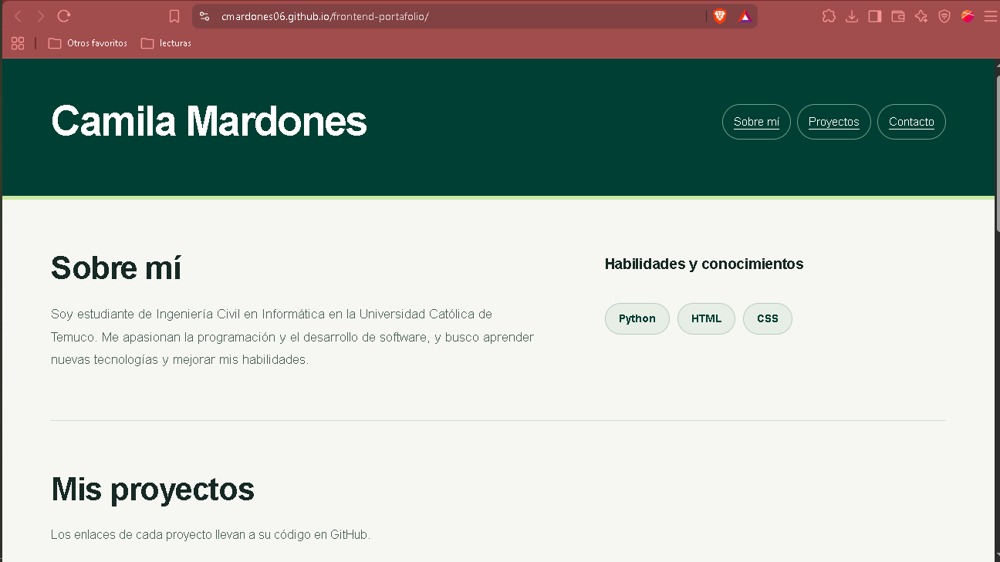

# Declaración detallada de uso de inteligencia artificial

**Estudiante:** Camila Mardones  
**Asignatura:** Desarrollo de Frontend — ICINF1107, Universidad Católica de Temuco  
**Evaluación:** N.º 4 — Proyecto Integrado Final  
**Repositorio:** https://github.com/CMardones06/evaluacion_4-Camila_Mardones  
**Periodo de asistencia declarado:** 17 y 18 de noviembre de 2026.

Declaro que utilicé inteligencia artificial de manera sustantiva para analizar los requerimientos, generar código, recibir explicaciones, depurar errores, organizar el trabajo con Git y preparar documentación. Parte importante de los archivos completos del proyecto fue propuesta por la herramienta. No presento esos aportes como código escrito íntegramente sin asistencia.

Esta declaración combina una explicación técnica del proceso y un registro exhaustivo del texto de la conversación aportada. Las recomendaciones, las revisiones realizadas por la IA y las pruebas ejecutadas por mí se distinguen para no atribuir comprobaciones que no se efectuaron.

## 1. Herramientas utilizadas

| Dato | Identificación |
|---|---|
| Herramienta de IA | ChatGPT |
| Proveedor | OpenAI |
| Modelo declarado por la estudiante | GPT-6.1 sol |
| Nivel de razonamiento declarado | Medio |
| Canal de uso | Conversación en ChatGPT con mensajes, archivos PDF, capturas, código, enlaces y resultados de terminal. |
| Evidencia de interacción | PDF de la conversación, 134 páginas, 35 prompts y 35 respuestas del asistente. |

La identificación «GPT-6.1 sol, medio» fue confirmada por mí al entregar el PDF para elaborar esta declaración. Es una identificación declarada de la configuración utilizada, no una auditoría técnica de los modelos o del enrutamiento interno de cada mensaje. «Medio» corresponde al nivel de razonamiento declarado, no a otro producto.

**Aclaración sobre una respuesta anterior:** en el último intercambio del PDF, el asistente se describió como «Codex, basado en GPT-6» y reconoció no poder confirmar una variante exacta. Esa afirmación se conserva en el anexo como parte del registro histórico; no se utiliza como prueba de la identificación del modelo. La identificación de esta declaración procede de mi confirmación expresa: ChatGPT con GPT-6.1 sol y razonamiento medio.

La conversación no aporta evidencia de uso de Gemini, Claude, GitHub Copilot u otros asistentes en esta migración; por ello no se les atribuye participación.

Como herramientas de desarrollo utilicé VS Code, PowerShell, Node.js, npm, Git, GitHub y el navegador. React, Vite, TypeScript, React Router y ESLint son herramientas del proyecto, no asistentes de IA.

## 2. Propósito de uso y alcance de la asistencia

### 2.1. Interpretación y planificación

Compartí el repositorio de la E2, el repositorio nuevo, la rúbrica y el PDF de requisitos. Solicité una comparación y una lista detallada de tareas. La IA propuso conservar la identidad visual, migrar a componentes, utilizar rutas, integrar GitHub y organizar los documentos exigidos.

### 2.2. Configuración y control de versiones

La IA proporcionó comandos para clonar, configurar Vite con React y TypeScript, instalar dependencias, activar strict, crear ramas, registrar commits, subir cambios, abrir PR y actualizar ramas tras el merge. También propuso títulos y descripciones de los pull requests. Yo ejecuté los comandos y compartí sus resultados.

### 2.3. Generación de código y contenido

La herramienta propuso archivos completos y modificaciones de interfaces, datos, componentes, páginas, estilos, formulario, navegación, servicio HTTP, hook asíncrono, caché y gestión del tema. También redactó una presentación personal más amplia, categorías de habilidades, formación y objetivos. Esos textos requieren mi revisión para no atribuirme conocimientos o intereses que no me representen.

### 2.4. Depuración y revisión

Compartí mensajes de error, capturas y código. La IA interpretó resultados y propuso correcciones. Durante parte del proceso reportó revisiones de archivos obtenidos desde los repositorios. Cuando no pudo acceder al PR 5 lo reconoció y continuó a partir del diff que pegué en la conversación.

### 2.5. Documentación

La IA generó borradores de README.md, INVENTARIO.md y uso_ia.md. Solicité ampliar esta última declaración porque el primer borrador contenía solo prompts representativos y resúmenes. Esta nueva versión también fue redactada con asistencia de IA a partir del PDF aportado.

No se calculó un porcentaje de autoría porque no se llevó un registro que permita medirlo de forma fiable. La generación sustantiva de código y texto se reconoce expresamente.

## 3. Prompts utilizados y trazabilidad

El anexo A incluye los **35 prompts** del PDF, en su orden original, incluso confirmaciones breves, resultados de terminal, enlaces a PR y código con errores. Cada prompt tiene el mismo identificador que su respuesta. La tabla siguiente es un índice descriptivo; no reemplaza la transcripción.


| Intercambio | Asunto | Registro completo |
|---|---|---|
| 01 | Análisis inicial de E2 y de la rúbrica | [Prompt y respuesta](#intercambio-01) |
| 02 | Preparación del repositorio | [Prompt y respuesta](#intercambio-02) |
| 03 | Error de nombre del README y primer push | [Prompt y respuesta](#intercambio-03) |
| 04 | Consulta sobre ramas exigidas | [Prompt y respuesta](#intercambio-04) |
| 05 | Creación de Vite y dependencias | [Prompt y respuesta](#intercambio-05) |
| 06 | Instalación y advertencias de auditoría | [Prompt y respuesta](#intercambio-06) |
| 07 | Revisión del reporte npm audit | [Prompt y respuesta](#intercambio-07) |
| 08 | Build y lint de la base | [Prompt y respuesta](#intercambio-08) |
| 09 | Archivos sin seguimiento en Git | [Prompt y respuesta](#intercambio-09) |
| 10 | Revisión del PR 1 y tipado estricto | [Prompt y respuesta](#intercambio-10) |
| 11 | Rama creada antes del merge | [Prompt y respuesta](#intercambio-11) |
| 12 | Tipos y datos del portafolio | [Prompt y respuesta](#intercambio-12) |
| 13 | Tarjetas reutilizables y estilos | [Prompt y respuesta](#intercambio-13) |
| 14 | Encabezado, presentación y pie | [Prompt y respuesta](#intercambio-14) |
| 15 | Formulario controlado y contacto | [Prompt y respuesta](#intercambio-15) |
| 16 | Error de importación de AboutPage (captura) | [Prompt y respuesta](#intercambio-16) |
| 17 | Persistencia del error (captura) | [Prompt y respuesta](#intercambio-17) |
| 18 | Corrección y preparación del PR 2 | [Prompt y respuesta](#intercambio-18) |
| 19 | Revisión del PR 2 y estilos faltantes | [Prompt y respuesta](#intercambio-19) |
| 20 | Verificación de correcciones y nueva rama | [Prompt y respuesta](#intercambio-20) |
| 21 | Rutas, menú y página 404 | [Prompt y respuesta](#intercambio-21) |
| 22 | Preparación del PR de rutas | [Prompt y respuesta](#intercambio-22) |
| 23 | Revisión del PR 3 | [Prompt y respuesta](#intercambio-23) |
| 24 | Integración de GitHub REST API | [Prompt y respuesta](#intercambio-24) |
| 25 | Pruebas de carga, error y caché | [Prompt y respuesta](#intercambio-25) |
| 26 | Preparación del PR de API | [Prompt y respuesta](#intercambio-26) |
| 27 | Revisión del PR 4 y duración de caché | [Prompt y respuesta](#intercambio-27) |
| 28 | Solicitud de mejoras de contenido | [Prompt y respuesta](#intercambio-28) |
| 29 | Perfil ampliado y tema con Context API | [Prompt y respuesta](#intercambio-29) |
| 30 | Corrección de ThemeProvider | [Prompt y respuesta](#intercambio-30) |
| 31 | Verificación y preparación del PR del tema | [Prompt y respuesta](#intercambio-31) |
| 32 | Acceso fallido al PR 5 | [Prompt y respuesta](#intercambio-32) |
| 33 | Revisión mediante diff compartido | [Prompt y respuesta](#intercambio-33) |
| 34 | Borradores de documentación | [Prompt y respuesta](#intercambio-34) |
| 35 | Solicitud de declaración exhaustiva | [Prompt y respuesta](#intercambio-35) |


El mensaje 16 contiene una captura sin texto extraíble; el mensaje 17 también se acompañó de una captura. Las imágenes forman parte del material enviado y deben consultarse en el PDF original. No se reconstruye ni se inventa texto para sustituirlas.

La solicitud posterior de preparación de esta declaración —«te adjunto toda la conversacion realizada con chatgpt-6.1 sol medio»— se registra como aportación adicional al final del anexo, fuera del recuento de los 35 intercambios contenidos en el PDF.

## 4. Respuestas recibidas y aportes de la herramienta

El anexo A conserva las **35 respuestas completas en su texto extraíble**, incluidos los archivos y comandos propuestos. La tabla identifica su contenido para facilitar la revisión, sin afirmar que cada recomendación se haya aplicado por el solo hecho de haber sido recibida.

| Intercambio | Respuesta y aporte principal |
|---|---|
| 01 | Comparación del repositorio y PDF con los nueve criterios; propuesta de arquitectura y tareas. |
| 02 | Comandos de clonación, comprobación de herramientas, README, main y rama inicial. |
| 03 | Renombrar READ.me a README.md; crear commit, publicar main y crear rama. |
| 04 | Explicación de ramas, commits, PR y niveles del criterio 8. |
| 05 | Comandos de Vite con plantilla react-ts, instalación y React Router. |
| 06 | Instrucciones para imágenes, captura E2, restauración del README y consulta de npm audit. |
| 07 | Interpretación de picomatch y recomendación de no aplicar una actualización forzada; build y lint. |
| 08 | Instrucciones de commit, push y creación del PR 1 con descripción. |
| 09 | Explicación de archivos sin seguimiento y comandos para incorporarlos. |
| 10 | Revisión reportada del PR 1; propuesta de activar strict y preparar la migración. |
| 11 | Actualización de main y merge hacia la rama creada anticipadamente. |
| 12 | Código completo de interfaces y portfolioData.ts con tres proyectos originales. |
| 13 | Código de ProyectoCard, ProjectsPage, App y estilos iniciales. |
| 14 | Código de Header, AboutPage, Footer, tipos y CSS complementario. |
| 15 | Código de ContactForm, ContactPage, tipos, App y estilos; validación y mailto. |
| 16 | Diagnóstico de importación y propuesta de comprobar nombre, ubicación y contenido del archivo. |
| 17 | Guardar, reiniciar el servidor TypeScript y ejecutar build para distinguir un aviso del editor. |
| 18 | Instrucciones de verificación, commit, push y descripción del PR 2. |
| 19 | Detección reportada de CSS reemplazado, clase about_skills y nombre ContacPage. |
| 20 | Confirmación reportada de estilos y clase corregidos; merge y rama de rutas. |
| 21 | Código de navegación, Navbar, HomePage, 404, Header, Footer y App con foco y título. |
| 22 | Comandos Git y descripción para el PR 3. |
| 23 | Revisión reportada de rutas, NavLink, Link, foco y título; rama de API. |
| 24 | Código de tipos, configuración, servicio, validación de unknown, hook, tarjetas, estados y caché. |
| 25 | Pasos de pruebas manuales con red lenta, offline, reintento y caché entre rutas. |
| 26 | Comandos Git y descripción del PR de API. |
| 27 | Detección reportada de 5 × 60 × 100; corrección a 5 × 60 × 1000 milisegundos. |
| 28 | Alternativas de mejora; recomendación de contenido personal, habilidades y tema. |
| 29 | Código de perfil ampliado, formación, objetivos, contexto, proveedor, hook, botón y CSS oscuro. |
| 30 | Corrección del operador lógico, import type, anotación de props y cadena light. |
| 31 | Pruebas de persistencia y legibilidad; comandos y descripción del PR 5. |
| 32 | Reconocimiento de imposibilidad de acceder al PR 5 y solicitud de git diff. |
| 33 | Revisión del diff recibido; aclaración de que perfil y CSS no estaban incluidos. |
| 34 | Generación de README, INVENTARIO y primer uso_ia.md, con reflexión propuesta. |
| 35 | Reconocimiento de que el primer documento era resumido; propuesta de seis secciones y anexo íntegro. |


### Archivos y decisiones con asistencia sustantiva

- **Tipos y datos:** interfaces del perfil, proyectos, props, formulario, navegación, respuesta de GitHub y tema; módulos de datos separados.
- **Interfaz:** Header, Navbar, Footer, ProyectoCard, AboutPage, ProjectsPage, ContactPage, HomePage y NotFoundPage.
- **Formulario:** valores controlados, validación, errores asociados a campos, confirmación y enlace mailto codificado.
- **Rutas:** BrowserRouter, Routes, Route, NavLink, Link, ruta comodín, actualización de título y gestión del foco.
- **GitHub:** configuración del endpoint, servicio, validación de unknown, hook con estados, AbortController, caché temporal y tarjetas.
- **Tema:** ThemeContext, ThemeProvider, useTheme, ThemeToggle, persistencia y estilos alternativos.
- **Estilos:** adaptación del CSS original y clases BEM. Los estilos propuestos se concentraron en index.css; no se debe afirmar que se implementó un archivo CSS separado por cada componente si no se hizo.
- **Documentación:** textos de README, inventario, declaración de IA y descripciones de PR.

## 5. Ajustes, refactorización y verificación

### 5.1. Correcciones concretas documentadas

| Situación | Ajuste realizado o indicado | Evidencia en la conversación |
|---|---|---|
| El archivo inicial se llamaba READ.me. | Renombrarlo a README.md antes de añadirlo y crear el primer commit. | 03 y 05. |
| Se creó una rama antes del merge. | Actualizar main e integrar main en la rama existente. | 11 y 12. |
| La configuración no incluía strict. | Agregar strict: true en tsconfig.app.json. | 10. |
| App no encontraba AboutPage. | Revisar ubicación y nombre, guardar y reiniciar el servidor TypeScript. | 16–18. |
| El CSS anterior se reemplazó al agregar contacto. | Recuperar estilos generales, tarjetas, presentación, encabezado y pie. | 19 y 20. |
| La clase about_skills no coincidía con BEM. | Corregir a about__skills. | 19 y 20. |
| La función de contacto se llamaba ContacPage. | Corregir el nombre a ContactPage; no era un fallo de importación por defecto. | 19. |
| La caché estaba escrita como 5 * 60 * 100. | Corregir a 5 * 60 * 1000, es decir, cinco minutos. | 27. |
| ThemeProvider tenía errores de sintaxis. | Usar ||, import type, anotación correcta de props y la cadena "light" entre comillas. | 30. |
| No se pudo acceder al PR 5. | Revisar el diff compartido, sin dar por revisados el CSS y el perfil ausentes del fragmento. | 32 y 33. |
| La primera declaración era resumida. | Solicitar un registro exhaustivo respaldado por el PDF. | 34 y 35. |

### 5.2. Verificaciones ejecutadas y comunicadas

Las pruebas locales fueron ejecutadas por mí y sus resultados fueron compartidos mediante salidas de terminal o confirmaciones. La IA no ejecutó npm en mi computador Windows.

- Se compartieron compilaciones exitosas de npm run build y resultados de npm run lint sin errores.
- Se confirmó que aparecían los repositorios reales de GitHub.
- Después de recibir instrucciones de prueba de red lenta, offline, reintento y caché, confirmé que todo funcionaba. El registro contiene confirmaciones textuales; no constituye un informe automatizado de esas pruebas.
- Se indicaron pruebas del formulario vacío, correo inválido, espacios y datos válidos. Las confirmaciones generales no equivalen a una captura individual de cada caso.
- Para el tema se indicaron pruebas de cambio entre rutas, recarga y legibilidad. La lógica del tema fue revisada mediante diff. No se debe atribuir a ese diff una auditoría visual del CSS.

### 5.3. Decisiones y límites técnicos

- Se conservó el repositorio de E2 como referencia y se trabajó en uno nuevo.
- Se mantuvieron los proyectos originales y se añadieron repositorios recientes.
- El formulario prepara correo mediante mailto. No existe un backend que garantice su envío.
- El tema es transversal: el botón y la apariencia general comparten Context API.
- La caché de GitHub vive en memoria, se reinicia al recargar y comprueba su vigencia al solicitar datos; no es una sincronización automática cada cinco minutos.
- El uso de unknown y una comprobación de estructura evita tratar sin revisión el JSON externo como un tipo seguro.
- AbortController y las comprobaciones de señal cancelada previenen actualizaciones desde peticiones abandonadas.
- El reporte de npm audit señaló picomatch en dependencias. No se aplicó fix --force porque proponía un cambio mayor de Vite. El análisis de ese momento no certifica el estado futuro de las dependencias.

### 5.4. Verificaciones que no se pueden afirmar

El PDF no contiene un informe Lighthouse ni evidencia de una prueba con lector de pantalla. Tampoco acredita una auditoría completa WCAG AA, cobertura automatizada de pruebas, revisión exhaustiva en todos los dispositivos ni comprobación integral del estado final de main.

La corrección de sintaxis, una compilación exitosa y un lint limpio no prueban por sí solos fidelidad visual, contraste o funcionamiento de todos los enlaces externos. Las instrucciones de prueba recibidas de la IA se distinguen de las pruebas efectivamente documentadas.

## 6. Reflexión crítica final

**Nota de revisión personal:** el texto siguiente es una propuesta redactada con IA a partir del proceso documentado. Antes de entregar esta declaración debo revisarlo y modificarlo si no representa mi experiencia. No constituye una certificación de mis conocimientos.

El apoyo de la IA me permitió trabajar con ejemplos aplicados a mi portafolio y avanzar por etapas. También me mostró que incorporar archivos completos no asegura comprenderlos ni evita errores al trasladarlos al proyecto.

El problema de los estilos fue especialmente útil: el proyecto podía compilar y, aun así, perder la apariencia original. Por eso debo combinar TypeScript y ESLint con pruebas en el navegador. El error de la duración de la caché también mostró que un cálculo válido puede producir un comportamiento distinto del documentado.

Reconozco que la herramienta propuso gran parte de la implementación y de la documentación. Mi participación incluyó aportar el proyecto original, ejecutar instrucciones, integrar archivos, compartir errores y resultados, escoger mejoras y revisar el comportamiento. No sería correcto describir todo el código como escrito sin asistencia.

Para apropiarme del trabajo necesito explicar cómo un dato pasa del servicio al hook y después a la interfaz; qué diferencia hay entre props y estado; cuándo se ejecuta un efecto; por qué se cancela una petición; cómo funcionan las rutas y por qué el tema se comparte mediante contexto. Haber recibido una explicación no demuestra por sí solo que domine cada concepto.

El principal riesgo es depender de propuestas que no pueda defender. Mi responsabilidad es contrastarlas con los requisitos, corregirlas, comprobar sus límites y estudiar el código que entrego. Esta declaración deja constancia del apoyo recibido sin sustituir mi responsabilidad sobre el resultado.

---

## Anexo A. Registro íntegro del texto de la conversación aportada

### Fuente y alcance de la transcripción

- **Fuente:** Desarrollar Portafolio React TypeScript(1).pdf, 134 páginas.
- **Respaldo recomendado en el repositorio:** [PDF original de la conversación](docs/conversacion-ia.pdf).
- **Contenido registrado:** 35 prompts y 35 respuestas, en secuencia, incluidos textos de la pauta aportada, código, comandos, errores y confirmaciones.
- **Método:** extracción textual de todas las páginas del PDF y separación por los rótulos Tú y ChatGPT. Se retiraron únicamente encabezados, pies de impresión, publicidad repetida de la aplicación y duraciones de procesamiento mostradas por la interfaz.
- **Fidelidad:** se conservan los errores y propuestas históricas, sin reemplazarlos por versiones corregidas posteriores. Se preservan los saltos y espacios recuperados, salvo el margen común de impresión.
- **Limitaciones:** el PDF puede fragmentar palabras, caracteres, tablas y líneas de código. Las capturas y algunos elementos visuales no aparecen en la extracción. El PDF original es el respaldo para consultarlos. Los bloques siguientes son evidencia documental, no archivos de código listos para ejecutar.
- **Corte temporal:** el PDF termina con la respuesta a la solicitud de ampliar uso_ia.md. La posterior entrega del PDF y la creación de esta versión se declaran en el anexo B; no se inventan como parte del PDF.


### Intercambio 01

**Asunto:** Análisis inicial de E2 y de la rúbrica

**Prompt de la estudiante — texto extraído**

````````text

Requerimientos_Proyecto-React_Evalu…
                                                                                                                                                                 PDF


     hola chatgpt, necesito tu ayuda en el desarrollo de la parte final de mi proyecto de frontend. para esta entrega, debo basarme en mi proyecto de
     portafolio anterior, del cual te entrego su repositorio:   https://github.com/CMardones06/frontend-portafolio, como veras, es un trabajo sencillo al cual
     le debo agregar typescript y react. te adjunto los documentos que detallan la rubrica e indicaciones.


     Rúbrica Evaluación N°4 — PIF Proyecto Integrado Final
     Desarrollo de Frontend · ICINF1107 · Ingeniería Civil Informática · Docente: Cristian Iglesias Vera
     Proyecto individual construido en clase · Sesiones 29 (martes 17 de noviembre) y 30 (miércoles 18 de noviembre) · Entrega proyecto miércoles 18 de
     noviembre hasta las 15:00 hrs, URL del repositorio en Educa · Ponderación Evaluación 4: 40% de la nota final de la asignatura
     Estructura y Ponderación de la Evaluación N°4 (40% de la asignatura):Esta evaluación es un proceso dual diseñado para certificar competencias técnicas
     y asegurar la apropiación del conocimiento frente al uso de Inteligencia Artificial. Se compone de dos instancias obligatorias:
     • 1. Proyecto Integrado en React (Portafolio — 60% de la Evaluación 4): Evaluado mediante la presente rúbrica técnica. Plazo de entrega: miércoles 18 de
     noviembre hasta las 15:00 hrs.
     • 2. Cuestionario de Validación de Conocimientos (40% de la Evaluación 4): Aplicado de forma sincrónica en clase el miércoles 18 de noviembre de 15:00
     a 18:20 hrs para comprobar el dominio individual de los fundamentos implementados.


N    Criterio, descripción               0                       1                     2                     3                      4                       5             Punta
°       y ponderación               No logrado               Deficiente           Insuficiente          Aceptable                Bueno                 Excelente           je
                                                                                                                                                                          obten
                                                                                                                                                                           ido


1     Fidelidad al diseño        No entrega, o el           El diseño no       Conserva algunas        Conserva las        Reproduce fielmente     Idéntico al diseño
     de la Evaluación 2El         sitio no ejecuta.      corresponde al de     secciones, pero el     secciones y la        la estructura y el    de la E2 y mejorado
      portafolio en React                                la E2; se construyó     aspecto visual         paleta, con        diseño de la E2, con          donde
          conserva la                                     otro portafolio.          cambió          diferencias visibles     ajustes menores      correspondía, con la
         estructura, la                                                          notoriamente.       de maquetación.           justificados.       decisión explicada
       jerarquía visual, la                                                                                                                         en el README.
     paleta y la tipografía
         del portafolio
      entregado en la E2.
      Se compara contra
       la captura incluida
       en el repositorio.


       Ponderación: 15%


2       Componentes,           Todo el código vive         Componentes              Algunos         Un componente por      Composición clara,           Además,
            props y              en un archivo, sin        copiados y sin      componentes, con       sección, props        datos en archivos        componentes
        TypeScriptCada            componentes.            props; los tipos     la lógica mezclada   donde se necesitan      aparte, interfaces     reutilizables, tipos
         sección es un                                   están ausentes o       dentro del JSX y    y tipos declarados      tipadas y sin any.     exportados y una
       componente con                                       todo es any.        props sin tipar.       en las props.                                 estructura de
        responsabilidad                                                                                                                              carpetas que
        clara; los datos                                                                                                                            permite crecer.
       viajan por props y
         los tipos están
         declarados en
         TypeScript, sin
         recurrir a any.


       Ponderación: 12%


N    Criterio, descripción               0                        1                       2                     3                      4                       5             Punta
°       y ponderación               No logrado                Deficiente            Insuficiente            Aceptable               Bueno                  Excelente          je
                                                                                                                                                                             obten
                                                                                                                                                                              ido


3           Rutas y             Sin rutas; una sola        Enlaces que no           Algunas rutas       Todas las secciones       Además, la            Además, la ruta
        navegaciónLas             página estática.         llevan a ninguna        funcionan, pero       navegables con       navegación indica la      inexistente está
         secciones del                                          parte.           faltan secciones del      React Router.       sección activa y el       manejada y la
         portafolio se                                                           portafolio de la E2.                         enlace al inicio está   navegación es clara
      navegan con React                                                                                                       siempre disponible.       en todo el sitio.
        Router, no con
        anclas ni scroll.


       Ponderación: 10%


4     Consumo de APIEl             No consume            Hay un fetch, pero el   Consume y muestra        fetch dentro de      Además, la lógica         Además, evita
      proyecto consume              ninguna API.         resultado nunca se        datos, pero sin      useEffect, estados    está separada en un     peticiones repetidas
       al menos una API                                  muestra o el código     estados de carga ni     de carga y error,      servicio o hook           o cachea el
      pública con fetch y                                quedó comentado.           de error, y la      datos renderizados    propio, el error se          resultado,
       useEffect, muestra                                                         respuesta se usa      y respuesta tipada.   muestra al usuario         documenta el
        los datos en la                                                              como any.                                  con un mensaje         contrato de la API
      interfaz y distingue                                                                                                      claro y se evitan       en el README y
       los estados de la                                                                                                        condiciones de           explica en la
      petición: cargando,                                                                                                           carrera.           defensa por qué
        éxito y error. La                                                                                                                             eligió ese endpoint.
         respuesta está
      tipada y el endpoint
             queda
         documentado.


       Ponderación: 20%


N    Criterio, descripción               0                        1                     2                      3                      4                     5               Punta
°       y ponderación               No logrado               Deficiente            Insuficiente            Aceptable               Bueno                Excelente            je
                                                                                                                                                                            obten
                                                                                                                                                                             ido


5         Gestión del          No hay estado: todo       El estado se guarda    Usa useState donde    useState y useEffect     Además, eleva el       Además, usa
      estadoEl estado se         el contenido está       en variables sueltas    correspondía un      se usan con criterio;   estado cuando dos   Context API cuando
         declara donde         escrito a mano en el      o está duplicado en    efecto, o useEffect   cada estado vive en      componentes lo         el estado es
       corresponde y se                 JSX.             varios componentes.    para calcular algo    el componente que       comparten y no lo   transversal y justifica
         comparte sin                                                               derivado.             lo necesita.             duplica.           esa decisión.
      duplicarlo: useState
         para lo local,
       useEffect para los
       efectos, y Context
         API cuando el
           estado es
         transversal. El
          estado de la
       llamada asíncrona
     —cargando, datos y
      error— se gestiona
      de forma explícita y
          no queda en
       variables sueltas.


       Ponderación: 10%


N    Criterio, descripción               0                        1                      2                   3                    4                    5            Punta
°       y ponderación               No logrado                Deficiente            Insuficiente         Aceptable             Bueno               Excelente         je
                                                                                                                                                                    obten
                                                                                                                                                                     ido


6      Funcionalidades            No se recuperó          Quedaron como           Alguna funciona,     Las principales       Además, el           Además, las
       recuperadas de la              ninguna               maqueta, sin           pero varias se        funcionan:      formulario valida y   funcionalidades se
      E2Las interacciones          funcionalidad.         comportamiento.         perdieron en la      navegación y           muestra            mejoraron y el
       que el portafolio                                                             migración.         formulario.        confirmación.       manejo de errores
      tenía en JavaScript                                                                                                                          es claro.
      siguen funcionando:
       menú, formulario,
     modo oscuro, filtros
            u otras.


       Ponderación: 8%


7       Accesibilidad y         No se puede usar          Todo son div con          Hay algo de       HTML semántico,      Además, foco        Además, revisión
             diseño               en móvil ni con            onclick; sin        semántica, pero el   formularios con     visible, contraste   con Lighthouse o
       responsivoHTML                 teclado.           etiquetas, sin foco y   layout se rompe en   label asociado y       suficiente y      lector de pantalla
     semántico, etiquetas                                 sin adaptación a       pantalla pequeña.    layout usable en      navegación         documentada en el
        asociadas a los                                         móvil.                                     móvil.          completa por            README.
         campos, foco                                                                                                         teclado.
       visible, contraste
     suficiente y un layout
      que se usa bien en
     pantalla de teléfono.


       Ponderación: 8%


N    Criterio, descripción               0                       1                     2                      3                       4                     5             Punta
°       y ponderación               No logrado               Deficiente           Insuficiente           Aceptable                 Bueno                Excelente          je
                                                                                                                                                                          obten
                                                                                                                                                                           ido


8    Flujo de trabajo con      No hay repositorio,       Todo se hizo sobre     Commits sobre       Al menos una rama        Además, el historial   Además, revisó su
        GitEl repositorio         o hay un único         main, con mensajes    main, sin ramas ni     de funcionalidad       es legible y el pull   propio pull request
      muestra un trabajo         commit con todo.        del tipo «cambios».     pull request.      con su pull request y     request describe       con criterio: qué
     ordenado: rama por                                                                             commits feat: / fix: /   qué cambia y cómo        cambia, cómo
         funcionalidad,                                                                                    docs:.                 probarlo.           probarlo y qué
          commits con                                                                                                                                   corregiría.
           mensajes
      convencionales, pull
          request con
     descripción y merge
             a main.


       Ponderación: 7%


N    Criterio, descripción               0                        1                       2                        3                       4                      5           Punta
°       y ponderación               No logrado               Deficiente              Insuficiente             Aceptable                 Bueno                Excelente         je
                                                                                                                                                                              obten
                                                                                                                                                                               ido


9      Documentación e           Sin README, sin          README de una          Falta la captura de         README con               Además, el          Además, reflexión
          informe del               inventario ni        línea; sin inventario   la E2 o el inventario       instalación y         inventario explica      crítica propia y
       proyectoREADME            declaración de IA.         ni uso_ia.md.         está incompleto.       ejecución, inventario,   qué se conservó y       declaración de IA
           ejecutable,                                                                                   captura y uso_ia.md      qué se corrigió, y el   coherente con lo
     INVENTARIO.md con                                                                                       con las seis         README documenta         que se ve en el
      lo recuperado de la                                                                                     secciones.             la API usada.            código.
        E2, captura del
      portafolio original y
       uso_ia.md con las
         seis secciones
        trabajadas en la
           sesión 27:
      herramientas, para
        qué se usaron,
        prompts, qué se
        recibió, qué se
       ajustó y cómo se
      verificó, y reflexión
              final.


       Ponderación: 10%


Total de puntos:         / 100                                                                NOTA PROYECTO (60% E4):


Cómo se calcula la notaPuntaje del criterio = (puntaje de 0 a 5 ÷ 5) × ponderación. Ejemplo: 4 puntos en el criterio 4 → (4 ÷ 5) × 20 = 16 puntos. Total =
suma de los nueve criterios, sobre 100. Nota del proyecto con exigencia del 60%: de 0 a 60 puntos se convierte de 1,0 a 4,0, y de 60 a 100 puntos de 4,0 a
7,0. La nota final de la Evaluación 4 se obtiene ponderando el60% de esta rúbrica + el 40% del cuestionario de validación.


Condiciones de la entrega y ajustes razonablesLa entrega del proyecto es la URL del repositorio publicada en Educa hasta las15:00 horas del miércoles 18
de noviembre de 2026; cualquier commit o push posterior no se considera. El proyecto se entrega en unrepositorio nuevo, creado desde cero, con el
nombreevaluacion_4-nombre_apellido; el repositorio de la Evaluación 2 se conserva aparte como referencia visual y su captura se incluye en el repositorio


   nuevo. El repositorio debe incluir el proyecto que consume al menos una API pública: sin consumo de API, el criterio 4 se evalúa en 0 y el puntaje máximo
   del instrumento baja a 80 puntos. Sinuso_ia.md, el criterio 9 se evalúa como máximo en nivel Aceptable (6 puntos). Debe incluir además una captura del
   portafolio de la Evaluación 2, referenciada desde el README. La validación individual se realiza mediante el cuestionario sincrónico (40%) el miércoles 18
   de noviembre de 15:00 a 18:20 hrs. Los ajustes razonables vigentes se aplican antes de la evaluación, sin modificar criterios ni niveles; la retroalimentación
   se entrega después, una vez revisados todos los repositorios.


   por ultimo, te adjunto el nuevo repositorio vacio que cree segun lo solicitado:           https://github.com/CMardones06/evaluacion_4-Camila_Mardones


   la api que pienso implementar es la de api rest github
   necesito que analizes mi entrega anterior y generas una lista detallada de las tareas que debo realizar para cumplir con lo que pide la rúbrica.


Ha pensado durante 1m 4s

````````

**Respuesta de ChatGPT — texto extraído**

````````text

Hola, Camila. Tu portafolio anterior sir ve como base: debes conser var su diseño y contenido, pero reorganizarlo como una aplicación React con TypeScript, rutas y datos de GitHub. La entrega exige más que cambiar los
archivos de .html a .tsx .

Revisé el código del         repositorio anterior, su captura de escritorio y las especificaciones del PDF adjunto. El nuevo repositorio no presenta ramas publicadas, consistente con que está vacío.


1. Qué tienes y qué debes conservar

Elemento actual                                                   Resultado de la revisión                                                                   Trabajo necesario


Presentación personal                                             Biografía y habilidades: Python, HTML y CSS.                                               Pasarlas a datos tipados y componentes.


Proyectos                                                         Tres tarjetas: paleta de colores, calculadora de rutas y animación matemática.             Conservar textos, imágenes y enlaces; convertirlas en un componente reutilizable.


Contacto                                                          Correo y formulario con nombre, correo y mensaje.                                          Incorporar estado, validación y confirmación en React.


Navegación                                                        Enlaces #sobre-mi , #proyectos , #contacto y #inicio .                                     Sustituir la navegación entre secciones por React Router.


Diseño                                                            Encabezado verde oscuro, fondo claro, Arial, tarjetas redondeadas y detalles verde lima.   Conservar esta identidad visual.


Adaptación a pantallas                                            CSS con cambios desde 480, 768 y 1024 px.                                                  Reutilizar la distribución y comprobarla después de migrar.


Elemento actual                                                   Resultado de la revisión                                                             Trabajo necesario


Accesibilidad                                                     HTML semántico, etiquetas, textos alternativos, salto al contenido y foco visible.   Mantener estas medidas y adaptarlas a JSX y a las rutas.


JavaScript                                                        No hay scripts ni archivos JavaScript.                                               No tienes menú hamburguesa, filtros ni modo oscuro que recuperar.


Documentación                                                      README.md y USO_IA.txt .                                                            Actualizar el README y crear INVENTARIO.md y uso_ia.md .


Encontré dos detalles que debes corregir en la documentación nueva:

        El README anterior menciona accesibilidad.css , pero ese archivo no está en el repositorio: sus estilos están integrados en style.css .
        Indica un ancho máximo de 1100 px, mientras el CSS utiliza 1160 px.

El formulario actual tiene validación nativa y una acción mailto ; no hay un ser vicio que envíe mensajes ni una confirmación programada. En el inventario conviene describirlo así.


2. Lista detallada de tareas

Las siguientes tareas combinan la rúbrica y los requisitos adicionales del PDF.          Requerimientos_Proyecto-React_Evaluacion_4_ICINF1107.pdf

1) Preparar el proyecto nuevo y registrar la referencia de E2

             Trabajar en evaluacion_4-Camila_Mardones , conservando aparte el repositorio anterior.
             Crear la base con Vite + React + TypeScript.
             Instalar react-router-dom .
             Configurar TypeScript con comprobaciones estrictas.
             Mantener package-lock.json y un .gitignore que excluya node_modules y dist .
             Copiar las tres imágenes de proyectos a src/assets/ .
             Incluir una captura de la E2 en docs/captura-e2.png . Puedes aprovechar la captura existente si representa la entrega original; una captura completa ayudaría a comparar todas las secciones.
             Crear desde el comienzo la bitácora uso_ia.md e incorporar esta consulta.

Comprobación: el proyecto inicia con npm run dev y la captura original queda disponible en el repositorio nuevo.

2) Migrar el diseño sin cambiar su identidad — criterio 1, 15%

             Conservar encabezado, nombre, paleta, Arial, botones del menú y pie.
             Mantener la presentación personal y las habilidades.
             Mantener las tres tarjetas originales con sus capturas.
             Conservar el aspecto del formulario y la distribución responsiva.
             Comparar la versión React con las capturas de E2.


           Explicar en el README los cambios necesarios por las rutas y la incorporación de GitHub.

Recomendación: conservar los tres proyectos destacados y agregar debajo un bloque “Repositorios recientes de GitHub”. Así mantienes la referencia visual y muestras claramente el consumo de API.

3) Separar componentes, datos y tipos — criterio 2, 12%

Ubicación propuesta                                                                                             Responsabilidad


 src/components/Header.tsx                                                                                      Encabezado e identidad.


 src/components/Navbar.tsx                                                                                      Navegación y ruta activa.


 src/components/Footer.tsx                                                                                      Pie y enlace al inicio.


 src/components/ProjectCard.tsx                                                                                 Tarjeta reutilizable de los proyectos originales.


 src/components/RepositoryCard.tsx                                                                              Tarjeta para un repositorio obtenido de GitHub.


 src/components/ContactForm.tsx                                                                                 Campos, validación y resultado del formulario.


 src/components/StatusMessage.tsx                                                                               Mensajes de carga, error o lista vacía.


 src/pages/                                                                                                     Vistas de inicio, sobre mí, proyectos, contacto y página inexistente.


 src/data/portfolioData.ts                                                                                      Biografía, habilidades y proyectos originales.


 src/types/index.ts                                                                                             Tipos exportados de datos, props, estado y API.


 src/hooks/useGitHubRepos.ts                                                                                    Petición, estado asíncrono y limpieza.


 src/services/githubService.ts                                                                                  Comunicación HTTP con GitHub.


           Pasar datos a las tarjetas mediante props tipadas.
           Tipar estados y eventos del formulario.
           Evitar any .
           Usar identificadores estables como key en las listas.
           Evitar que App.tsx termine conteniendo todo el portafolio.


Comprobación: puedes modificar un proyecto desde portfolioData.ts sin editar el JSX de la tarjeta.

4) Implementar las rutas — criterio 3, 10%

Ruta propuesta                                                                    Contenido


 /                                                                                Inicio con una presentación breve.


 /sobre-mi                                                                        Biografía y habilidades originales.


 /proyectos                                                                       Proyectos destacados y repositorios de GitHub.


 /contacto                                                                        Correo y formulario.


 *                                                                                Mensaje de página inexistente y regreso al inicio.


           Utilizar BrowserRouter , Routes y Route , como exige el PDF.
           Usar NavLink en el menú para identificar la ruta activa.
           Usar Link para volver al inicio.
           Mantener encabezado, menú y pie compartidos entre las vistas.
           Comprobar los botones Atrás y Adelante del navegador.
           Gestionar el foco al cambiar de vista para facilitar el uso con teclado.

El salto accesible al contenido tiene otra función: debe seguir permitiendo omitir el menú. No lo utilices como sustituto de las rutas.

5) Integrar GitHub REST API — criterio 4, 20%

El endpoint indicado en el PDF, adaptado a tu usuario, es:

https://api.github.com/users/CMardones06/repos?sort=updated&per_page=6

Permite consultar repositorios públicos sin autenticación.      GitHub Docs


           Definir GitHubRepo con estos campos:

Campo                                                                                                                                  Tipo


 id                                                                                                                                    number


Campo                                                                                                                                 Tipo


 name                                                                                                                                  string


 description                                                                                                                           string | null


 html_url                                                                                                                              string


 language                                                                                                                              string | null


 stargazers_count                                                                                                                      number


 updated_at                                                                                                                            string


            Ejecutar fetch desde un useEffect , preferentemente encapsulado en el hook.
            Comprobar response.ok .
            Mostrar nombre, descripción, lenguaje, estrellas y enlace al código.
            Resolver descripciones y lenguajes null con mensajes adecuados.
            Mostrar explícitamente cargando, éxito y error.
            Añadir un mensaje para una respuesta vacía.
            Implementar AbortController y cancelar la petición en la limpieza del efecto.
            Evitar actualizaciones provenientes de peticiones canceladas o anteriores.
            Para aspirar al nivel excelente, cachear el resultado con una vigencia definida y evitar peticiones innecesarias al volver a la vista.
            Documentar endpoint, parámetros, campos y justificación.

Comprobación: probar conexión normal, red lenta y falta de conexión. Los errores deben quedar visibles en la interfaz.

GitHub limita las consultas sin autenticación a 60 por hora por IP; la caché es especialmente útil si varias personas comparten la red de la universidad.   GitHub Docs


6) Organizar el estado — criterio 5, 10%

            Mantener los valores y errores del formulario en ContactForm .
            Mantener carga, datos y error de GitHub en el hook.
            Evitar copiar los mismos repositorios a varios estados.
            Si agregas un filtro, calcular la lista filtrada a partir de los datos existentes.
            Elevar estado solo cuando varios componentes necesiten compartirlo.

Para aspirar al nivel 5: agregar un tema claro/oscuro mediante ThemeContext , compartido por el botón del encabezado y la aplicación. El tema claro debe conservar el diseño original y la decisión debe justificarse en el
README.


No es una funcionalidad que ya tengas: sería una mejora para demostrar estado transversal. Si no incorporas estado global, explica por qué tu aplicación se resuelve con estado local.

7) Hacer funcional el contacto — criterio 6, 8%

            Convertir los campos en controles gestionados con React.
            Validar nombre, correo y mensaje.
            Rechazar nombre o mensaje compuestos solo por espacios.
            Mantener límites de longitud.
            Mostrar errores junto a los campos.
            Asociar errores mediante aria-describedby y usar aria-invalid cuando corresponda.
            Mostrar una confirmación accesible después de validar.

Puedes mantener el propósito de “Preparar correo”: validar y ofrecer un enlace mailto con asunto y mensaje codificados. La confirmación debe decir “Mensaje preparado para abrir en tu aplicación de correo”, sin afirmar que
fue enviado.

No necesitas construir un backend de correo para esta entrega.

8) Refactorizar el CSS con BEM — requisito explícito del PDF

            Conservar las variables de color originales.
            Separar estilos base de los estilos de componentes.
            Sustituir selectores dependientes de secciones e identificadores por clases BEM.

Selector actual                                                                                               Ejemplo de destino BEM


 .cabecera-contenido                                                                                           .header__content


 .tarjetas-proyectos                                                                                           .projects__grid


 .tarjeta                                                                                                      .project-card


 .imagen-proyecto                                                                                              .project-card__image


 .campo                                                                                                        .contact-form__field


 .boton                                                                                                        .contact-form__submit


Estado activo del menú                                                                                         .navbar__link--active


Comprobación: cambiar los nombres de las clases no modifica el aspecto de la E2.


9) Revisar accesibilidad y responsividad — criterio 7, 8%

           Mantener HTML semántico y jerarquía de títulos.
           Convertir for en htmlFor , class en className y los atributos JSX correspondientes.
           Mantener textos alternativos de las imágenes.
           Incorporar :focus-visible .
           Anunciar carga y confirmación con role="status" o aria-live ; errores con un mecanismo adecuado.
           Comprobar contraste, también si incorporas tema oscuro.
           Probar desde 320 px, sin desplazamiento horizontal.
           Recorrer todo usando Tab, Shift+Tab y Enter.
           Ejecutar Lighthouse y documentar resultados reales y correcciones.

10) Registrar el trabajo con Git — criterio 8, 7%

El historial debe construirse durante el desarrollo.

           Crear ramas por funcionalidad, por ejemplo feat/migracion-react , feat/rutas , feat/github-api y feat/formulario .
           Registrar cambios coherentes mediante commits convencionales:

feat: migra las secciones del portafolio a React
feat: incorpora las rutas y la página 404
feat: muestra repositorios desde GitHub
fix: corrige la validación del formulario
style: adapta los componentes a BEM
docs: documenta la migración y el uso de IA

           Abrir pull requests con descripción y pasos para probar.
           Revisar tus propios cambios antes de integrar.
           Registrar qué comprobaste y qué corregiste.
           Hacer merge a main y verificar su versión final.

11) Completar la documentación — criterio 9, 10%

Archivo                                                                                          Contenido necesario


 README.md                                                                                       Descripción, requisitos, instalación, ejecución, build, preview, rutas, API, decisiones, captura E2 y revisión de accesibilidad.


 INVENTARIO.md                                                                                   Qué recuperaste de E2, archivo de origen, componente de destino, cambios y correcciones.


Archivo                                                                                              Contenido necesario


 uso_ia.md                                                                                           Las seis secciones oficiales y un registro fiel del apoyo recibido.


 docs/captura-e2.png                                                                                 Evidencia visual enlazada desde el README.


Las seis secciones de uso_ia.md son:

    1. Herramientas utilizadas.
    2. Propósito de uso.
    3. Prompts representativos.
    4. Output recibido.
    5. Ajustes, refactorización y verificación.
    6. Reflexión crítica final.

12) Verificar y entregar

           Ejecutar npm install .
           Comprobar npm run dev .
           Ejecutar npm run build sin errores de TypeScript.
           Revisar la compilación mediante npm run preview .
           Probar todas las rutas y una URL inexistente.
           Probar API, formulario, teclado y vista móvil.
           Confirmar que main contiene todos los cambios y documentos.
           Publicar la URL del repositorio en Educa antes del miércoles 18 de noviembre de 2026 a las 15:00, hora de Chile.

Si publicas también una demostración, comprueba la recarga directa de las rutas: el alojamiento debe estar configurado para servir la SPA con BrowserRouter .


3. Orden recomendado para avanzar

    1. Base y evidencia: Vite, captura E2, imágenes y primera rama.
    2. Migración visual: componentes, datos tipados y CSS BEM.
    3. Navegación: rutas, enlace activo y 404.
    4. API de GitHub: tarjetas, estados, cancelación y caché.
    5. Interacciones: formulario y, si lo incorporas, tema global.
    6. Verificación: accesibilidad, móvil y compilación.
    7. Cierre: documentación, revisión del PR, merge y entrega.


También debes reservar tiempo para comprender lo implementado: el cuestionario representa el 40% de la E4. Mientras desarrollas, asegúrate de poder explicar props, estado, dependencias y limpieza de useEffect ,
 AbortController , tipos, rutas y el recorrido de los datos desde GitHub hasta cada tarjeta.

````````


### Intercambio 02

**Asunto:** Preparación del repositorio

**Prompt de la estudiante — texto extraído**

````````text

empecemos a trabajr con el punto numero 1

````````

**Respuesta de ChatGPT — texto extraído**

````````text

Vamos con el punto 1: preparar el proyecto nuevo. Lo haremos paso a paso en tu computador, usando la terminal de PowerShell en VS Code.

1. Clona el repositorio nuevo

Abre una terminal en la carpeta donde quieres guardar el proyecto y ejecuta:

git clone https://github.com/CMardones06/evaluacion_4-Camila_Mardones.git

Si aparece que clonaste un repositorio vacío, es normal.

Después entra en la carpeta y ábrela en VS Code:

cd evaluacion_4-Camila_Mardones
code .

2. Comprueba las herramientas

En VS Code, abre Terminal → Nueva terminal y ejecuta:

node --version
npm --version
git --version

3. Prepara la rama principal

Primero crearemos un README mínimo para que main exista y después podamos hacer un pull request con la configuración de React.

Crea un archivo llamado README.md en la raíz y escribe:

# Portafolio de Camila Mardones — Evaluación 4


Migración del portafolio de la Evaluación 2 a React y TypeScript,
con navegación mediante React Router y consumo de GitHub REST API.

Guárdalo y ejecuta:

git branch -M main
git add README.md
git commit -m "docs: inicia el repositorio de la evaluacion 4"
git push -u origin main

4. Crea la rama de trabajo

git switch -c feat/base-react

Aquí configuraremos React y TypeScript. El repositorio anterior se conserva aparte como referencia.

Envíame las versiones de Node y npm y el resultado del último comando. Con eso seguimos con la creación de Vite dentro de esta carpeta.

````````


### Intercambio 03

**Asunto:** Error de nombre del README y primer push

**Prompt de la estudiante — texto extraído**

````````text

PS C:\Users\Usuario\Videos\proyecto\evaluacion_4-Camila_Mardones> node --vers
     v24.19.0
     PS C:\Users\Usuario\Videos\proyecto\evaluacion_4-Camila_Mardones> npm --versi
     11.17.0
     PS C:\Users\Usuario\Videos\proyecto\evaluacion_4-Camila_Mardones> git --version
     git version 2.55.0.windows.3
     PS C:\Users\Usuario\Videos\proyecto\evaluacion_4-Camila_Mardones> git branch
     -M main
     PS C:\Users\Usuario\Videos\proyecto\evaluacion_4-Camila_Mardones> git add README.md
     fatal: pathspec 'README.md' did not match any files
     PS C:\Users\Usuario\Videos\proyecto\evaluacion_4-Camila_Mardones> git commit
     On branch main


     Initial commit


     Untracked files:
      (use "git add <file>..." to include in what will be committed)
          READ.me


     nothing added to commit but untracked files present (use "git add" to track)
     PS C:\Users\Usuario\Videos\proyecto\evaluacion_4-Camila_Mardones> git push -u origin main
     error: src refspec main does not match any
     error: failed to push some refs to 'https://github.com/CMardones06/evaluacion_4-Camila_Mardones.git'
     PS C:\Users\Usuario\Videos\proyecto\evaluacion_4-Camila_Mardones>

````````

**Respuesta de ChatGPT — texto extraído**

````````text

El archivo quedó nombrado READ.me , pero el comando buscaba README.md . Por eso no se creó el commit y el push también falló.

Ejecuta estos comandos, uno por uno:

Rename-Item -Path "READ.me" -NewName "README.md"

git add README.md

git commit -m "docs: inicia el repositorio de la evaluacion 4"

git push -u origin main

Cuando el push termine correctamente, crea la rama de trabajo:

git switch -c feat/base-react

Debería aparecer:

Switched to a new branch 'feat/base-react'

Envíame el resultado y seguimos con React y TypeScript.

````````


### Intercambio 04

**Asunto:** Consulta sobre ramas exigidas

**Prompt de la estudiante — texto extraído**

````````text

es necesario crear las ramas de trabajo? es algo solicitado por la rubrica o solamente es por comodiddad?

````````

**Respuesta de ChatGPT — texto extraído**

````````text

Sí, las ramas de trabajo están solicitadas explícitamente, no son solo por comodidad.

El criterio 8, “Flujo de trabajo con Git” (7%), pide:

         Ramas por funcionalidad.


         Commits con mensajes como feat: , fix: y docs: .
         Pull requests con descripción.
         Merge hacia main .

Además, el PDF exige ramas por funcionalidad y prohíbe realizar todo directamente sobre main en un único commit.

Según la rúbrica:

Forma de trabajar                                                                                                                                                                       Nivel


Commits sobre main , sin ramas ni PR                                                                                                                                                    2/5


Al menos una rama de funcionalidad, PR y commits convencionales                                                                                                                         3/5


Además, historial legible y PR con cambios y pasos para probar                                                                                                                          4/5


Además, revisión propia del PR con comprobaciones y correcciones                                                                                                                        5/5


El commit inicial del README en main sir ve para preparar el repositorio. Después trabajaremos en feat/base-react y abriremos un PR para integrar la configuración. Te iré guiando con los comandos cuando corresponda.

````````


### Intercambio 05

**Asunto:** Creación de Vite y dependencias

**Prompt de la estudiante — texto extraído**

````````text

PS C:\Users\Usuario\Videos\proyecto\evaluacion_4-Camila_Mardones> node --vers
     v24.19.0
     PS C:\Users\Usuario\Videos\proyecto\evaluacion_4-Camila_Mardones> npm --versi
     11.17.0
     PS C:\Users\Usuario\Videos\proyecto\evaluacion_4-Camila_Mardones> git --version
     git version 2.55.0.windows.3
     PS C:\Users\Usuario\Videos\proyecto\evaluacion_4-Camila_Mardones> git branch
     -M main
     PS C:\Users\Usuario\Videos\proyecto\evaluacion_4-Camila_Mardones> git add README.md
     fatal: pathspec 'README.md' did not match any files
     PS C:\Users\Usuario\Videos\proyecto\evaluacion_4-Camila_Mardones> git commit
     On branch main


     Initial commit


   PS C:\Users\Usuario\Videos\proyecto\evaluacion_4-Camila_Mardones> git push -u origin main
   error: src refspec main does not match any
   error: failed to push some refs to 'https://github.com/CMardones06/evaluacion
   PS C:\Users\Usuario\Videos\proyecto\evaluacion_4-Camila_Mardones> Rename-Item -Path "READ.me" -NewName "README.md"
   PS C:\Users\Usuario\Videos\proyecto\evaluacion_4-Camila_Mardones> git add README.md
   PS C:\Users\Usuario\Videos\proyecto\evaluacion_4-Camila_Mardones> git commit
   -m "docs: inicia el repositorio de la evaluacion 4"
   [main (root-commit) a0a88b6] docs: inicia el repositorio de la evaluacion 4
   1 file changed, 4 insertions(+)
   create mode 100644 README.md
   PS C:\Users\Usuario\Videos\proyecto\evaluacion_4-Camila_Mardones> git push -u
   Enumerating objects: 3, done.
   Counting objects: 100% (3/3), done.
   Compressing objects: 100% (2/2), done.
   Writing objects: 100% (3/3), 384 bytes | 384.00 KiB/s, done.
   Total 3 (delta 0), reused 0 (delta 0), pack-reused 0 (from 0)
   To https://github.com/CMardones06/evaluacion_4-Camila_Mardones.git
   * [new branch]         main -> main
   branch 'main' set up to track 'origin/main'.
   PS C:\Users\Usuario\Videos\proyecto\evaluacion_4-Camila_Mardones> git switch
   -c feat/base-react
   Switched to a new branch 'feat/base-react'


   yap, asi quedo, continuemos

````````

**Respuesta de ChatGPT — texto extraído**

````````text

Ya quedó creado main y estás en feat/base-react . Ahora vamos a instalar la base de React con TypeScript.

1. Crea el proyecto dentro de la carpeta actual

Ejecuta:

npm create vite@latest . -- --template react-ts

El punto . indica que debe usar la carpeta donde estás.

Si aparecen preguntas:


         Instalar create-vite : escribe y .
         La carpeta no está vacía: selecciona “Ignore files and continue” para conservar el README y Git.
         Nombre del paquete: si lo solicita, escribe evaluacion-4-camila-mardones .
         Instalar y ejecutar automáticamente: selecciona No, porque lo haremos con los siguientes comandos.

2. Instala las dependencias

Cuando termine la creación:

npm install

Después instala la biblioteca de rutas:

npm install react-router-dom

3. Comprueba que inicia

npm run dev

La terminal mostrará una dirección local, normalmente:

http://localhost:5173/

Ábrela en el navegador. Debería aparecer la pantalla inicial de Vite y React; todavía no tendrá el diseño de tu portafolio.

Envíame el resultado o cualquier pregunta que aparezca durante la instalación. Después incorporamos tus imágenes y la captura de la E2.

````````


### Intercambio 06

**Asunto:** Instalación y advertencias de auditoría

**Prompt de la estudiante — texto extraído**

````````text

PS C:\Users\Usuario\Videos\proyecto\evaluacion_4-Camila_Mardones> npm create
     vite@latest . -- --template react-ts
     Need to install the following packages:
     create-vite@9.3.4
     Ok to proceed? (y) y


     > npx
     > cva . --template react-ts


     create-vite v9.3.4


│
◇ Current directory is not empty. Please choose how to proceed:
│ Ignore files and continue
│
◇ Package name:
│ evaluacion-4-camila-mardones
│
◇ Which linter to use?
│ ESLint
│
◇ Install with npm and start now?
│ Yes
│
◇ Scaffolding project in C:\Users\Usuario\Videos\proyecto\evaluacion_4-Camila_Mardones...
│
◇ Installing dependencies with npm...


added 161 packages, and audited 162 packages in 3m


42 packages are looking for funding
 run npm fund for details


11 high severity vulnerabilities


To address issues that do not require attention, run:
 npm audit fix


To address all issues (including breaking changes), run:
 npm audit fix --force


Run npm audit for details.
│
◇ Starting dev server...


> evaluacion-4-camila-mardones@0.0.0 dev
> vite


 ➜ Local: http://localhost:5173/
 ➜ Network: use --host to expose
 ➜ press h + enter to show help
q
npm notice
npm notice New major version of npm available! 11.17.0 -> 12.2.2
npm notice Changelog: https://github.com/npm/cli/releases/tag/v12.2.2
npm notice To update run: npm install -g npm@12.2.2
npm notice
PS C:\Users\Usuario\Videos\proyecto\evaluacion_4-Camila_Mardones> npm install


up to date, audited 162 packages in 32s


42 packages are looking for funding
 run npm fund for details
11 high severity vulnerabilities


To address issues that do not require attention, run:
 npm audit fix


To address all issues (including breaking changes), run:
 npm audit fix --force


Run npm audit for details.
PS C:\Users\Usuario\Videos\proyecto\evaluacion_4-Camila_Mardones> npm install react-router-dom


added 4 packages, and audited 166 packages in 6s


43 packages are looking for funding
11 high severity vulnerabilities


To address issues that do not require attention, run:
 npm audit fix


To address all issues (including breaking changes), run:
 npm audit fix --force


   Run npm audit for details.
   PS C:\Users\Usuario\Videos\proyecto\evaluacion_4-Camila_Mardones> npm run dev


   > evaluacion-4-camila-mardones@0.0.0 dev
   > vite


   4:19:28 p. m. [vite] (client) Re-optimizing dependencies because lockfile has changed


    VITE v8.3.8 ready in 652 ms


    ➜ Local: http://localhost:5173/
    ➜ Network: use --host to expose
    ➜ press h + enter to show help
   npm run dev

````````

**Respuesta de ChatGPT — texto extraído**

````````text

La base de React y TypeScript ya está instalada y el ser vidor está funcionando. Abre http://localhost:5173/ para comprobar que aparece la pantalla de Vite y React.

Mientras el servidor está activo, esa terminal queda ocupada: no necesitas volver a escribir npm run dev . Para ejecutar otros comandos, abre otra terminal o detén el servidor con Ctrl+C.

Continuemos con los archivos del portafolio:

1. Recupera las imágenes originales

Descarga tu        repositorio anterior desde Code → Download ZIP y descomprímelo fuera del proyecto nuevo.

En VS Code, crea la carpeta src/assets/img y copia allí:

          colores.png
          rutas.png
          animacion.png

2. Agrega la captura de referencia

Crea una carpeta docs en la raíz, al mismo nivel que package.json .

Copia allí captura-escritorio.png del proyecto anterior y renómbrala:


captura-e2.png

3. Recupera el README inicial

Vite puede haber reemplazado el README que escribimos. Para recuperar el que ya guardaste en el primer commit, ejecuta en otra terminal:

git restore --source=HEAD -- README.md

4. Revisa las advertencias de dependencias

La instalación terminó, pero npm reporta 11 vulnerabilidades de severidad alta. Para identificar qué paquetes están involucrados, ejecuta:

npm audit

Envíame la salida de npm audit y confirma si abrió la pantalla de React. Revisaremos las correcciones antes de guardar esta base; por ahora no ejecutes npm audit fix --force , porque puede introducir cambios incompatibles.

````````


### Intercambio 07

**Asunto:** Revisión del reporte npm audit

**Prompt de la estudiante — texto extraído**

````````text

PS C:\Users\Usuario\Videos\proyecto\evaluacion_4-Camila_Mardones> npm audit
     # npm audit report


     picomatch *
     Severity: high
     picomatch vulnerable to ReDoS through single-branch repeated extglobs - https://github.com/advisories/GHSA-fc5q-39xc-vjpf
     fix available via npm audit fix --force
     Will install vite@6.2.7, which is a breaking change
     node_modules/picomatch
      fdir >=5.2.1
      Depends on vulnerable versions of picomatch
      node_modules/fdir
      tinyglobby *
      Depends on vulnerable versions of fdir
      Depends on vulnerable versions of picomatch
      node_modules/tinyglobby
       @typescript-eslint/typescript-estree >=8.47.1-alpha.0
       Depends on vulnerable versions of tinyglobby
       node_modules/@typescript-eslint/typescript-estree
        @typescript-eslint/parser >=8.47.1-alpha.0
        Depends on vulnerable versions of @typescript-eslint/typescript-estree


    node_modules/@typescript-eslint/parser
      @typescript-eslint/eslint-plugin >=8.47.1-alpha.0
      Depends on vulnerable versions of @typescript-eslint/parser
      Depends on vulnerable versions of @typescript-eslint/type-utils
      Depends on vulnerable versions of @typescript-eslint/utils
      node_modules/@typescript-eslint/eslint-plugin
    @typescript-eslint/type-utils >=8.47.1-alpha.0
    Depends on vulnerable versions of @typescript-eslint/typescript-estree
    Depends on vulnerable versions of @typescript-eslint/utils
    node_modules/@typescript-eslint/type-utils
    @typescript-eslint/utils >=8.47.1-alpha.0
    Depends on vulnerable versions of @typescript-eslint/typescript-estree
    node_modules/@typescript-eslint/utils
    typescript-eslint >=8.47.1-alpha.0
    Depends on vulnerable versions of @typescript-eslint/eslint-plugin
    Depends on vulnerable versions of @typescript-eslint/parser
    Depends on vulnerable versions of @typescript-eslint/typescript-estree
    Depends on vulnerable versions of @typescript-eslint/utils
    node_modules/typescript-eslint
 vite >=6.3.0-beta.0
 Depends on vulnerable versions of picomatch
 Depends on vulnerable versions of tinyglobby
 node_modules/vite
   @vitejs/plugin-react >=6.0.0-beta.0
   Depends on vulnerable versions of vite
   node_modules/@vitejs/plugin-react


11 high severity vulnerabilities


To address issues that do not require attention, run:
 npm audit fix


To address all issues (including breaking changes), run:
 npm audit fix --force
PS C:\Users\Usuario\Videos\proyecto\evaluacion_4-Camila_Mardones>

````````

**Respuesta de ChatGPT — texto extraído**

````````text

El reporte señala una vulnerabilidad en picomatch que afecta a varias dependencias de Vite y ESLint. El aviso oficial todavía no registra una versión corregida.   GitHub


No ejecutes npm audit fix --force : propone bajar Vite a otra versión mayor y podría generar incompatibilidades. Seguiremos con la configuración actual y dejaremos registrado este pendiente; la advertencia no impide
continuar desarrollando.

Para terminar de comprobar la base, detén el servidor con Ctrl+C, si está activo, y ejecuta:

npm run build

Esto verifica TypeScript y genera la compilación en dist .

Después ejecuta:

npm run lint

Esto revisa el código con ESLint.

Envíame ambos resultados. Si terminan correctamente, guardamos el avance en Git y hacemos el primer pull request. Asegúrate también de haber copiado las tres imágenes a src/assets/img/ y la captura original a
 docs/captura-e2.png .

````````


### Intercambio 08

**Asunto:** Build y lint de la base

**Prompt de la estudiante — texto extraído**

````````text

PS C:\Users\Usuario\Videos\proyecto\evaluacion_4-Camila_Mardones> npm run build


     > evaluacion-4-camila-mardones@0.0.0 build
     > tsc -b && vite build
     vite v8.3.8 building client environment for production...
     ✓ 20 modules transformed.
     computing gzip size...
     dist/index.html               0.47 kB │ gzip: 0.30 kB
     dist/assets/react-CHdo91hT.svg          4.12 kB │ gzip: 2.06 kB
     dist/assets/vite-BF8QNONU.svg           8.70 kB │ gzip: 1.60 kB
     dist/assets/hero-CLDdwZDr.png           13.05 kB
     dist/assets/index-D64VDMd1.css           4.10 kB │ gzip: 1.47 kB
     dist/assets/index-GpEN3EET.js 222.44 kB │ gzip: 69.28 kB


   ✓ built in 306ms
   PS C:\Users\Usuario\Videos\proyecto\evaluacion_4-Camila_Mardones> npm run lint


   > evaluacion-4-camila-mardones@0.0.0 lint
   > eslint .


   PS C:\Users\Usuario\Videos\proyecto\evaluacion_4-Camila_Mardones>

````````

**Respuesta de ChatGPT — texto extraído**

````````text

Ambas comprobaciones pasaron: TypeScript y la compilación no presentan errores, y ESLint tampoco encontró problemas.

Ahora guardaremos la base y crearemos el primer pull request.

1. Revisa los archivos que vas a guardar

git status

Confirma que estás en feat/base-react . Si ya copiaste las imágenes y la captura, deberían aparecer también src/assets/img/ y docs/ .

 node_modules y dist no deben aparecer como archivos pendientes, porque deben estar excluidos por .gitignore .

2. Guarda y sube el avance

Ejecuta uno por uno:

git add .

git commit -m "feat: configura la base de React con TypeScript"

git push -u origin feat/base-react

3. Crea el pull request en GitHub

Abre tu      repositorio nuevo y selecciona Compare & pull request. Verifica:

        base: main
        compare: feat/base-react

Como título utiliza:

feat: configura la base de React con TypeScript


Como descripción:

## Cambios
- Configura el proyecto con Vite, React y TypeScript.
- Instala react-router-dom para implementar la navegación.


## Verificación
- npm run build: completado sin errores.
- npm run lint: completado sin errores.


## Revisión propia
- Esta entrega contiene la base inicial; la migración del portafolio
     y las rutas se implementarán en las siguientes ramas.
- Queda pendiente la vulnerabilidad de picomatch reportada por npm audit.
     No se aplicó la actualización forzada porque propone un cambio
     incompatible de versión de Vite.

En Files changed, comprueba que no se incluyeron node_modules ni dist . Después pulsa Create pull request.

Envíame el enlace del PR antes de hacer el merge, para revisar esta primera base.

````````


### Intercambio 09

**Asunto:** Archivos sin seguimiento en Git

**Prompt de la estudiante — texto extraído**

````````text

PS C:\Users\Usuario\Videos\proyecto\evaluacion_4-Camila_Mardones> git status
     On branch feat/base-react
     Untracked files:
      (use "git add <file>..." to include in what will be committed)
          .gitignore
          docs/
          eslint.config.js
          index.html
          package-lock.json
          package.json
          public/
          src/
          tsconfig.app.json
          tsconfig.json
          tsconfig.node.json


          vite.config.ts


     nothing added to commit but untracked files present (use "git add" to track)
     PS C:\Users\Usuario\Videos\proyecto\evaluacion_4-Camila_Mardones>

````````

**Respuesta de ChatGPT — texto extraído**

````````text

Está correcto: estás en feat/base-react , aparecen los archivos nuevos y docs/ , y no aparecen node_modules ni dist .

“Untracked files” significa que Git todavía no los ha incorporado. Ejecuta estos comandos uno por uno:

git add .

git commit -m "feat: configura la base de React con TypeScript"

git push -u origin feat/base-react

Después abre tu         repositorio en GitHub, pulsa Compare & pull request y utiliza el título y la descripción del mensaje anterior.

Envíame el enlace del pull request para revisarlo.

````````


### Intercambio 10

**Asunto:** Revisión del PR 1 y tipado estricto

**Prompt de la estudiante — texto extraído**

````````text

https://github.com/CMardones06/evaluacion_4-Camila_Mardones/pull/1

````````

**Respuesta de ChatGPT — texto extraído**

````````text

Revisé el      PR #1. Incluye las imágenes originales, docs/captura-e2.png , React Router y los comandos de ejecución. No contiene node_modules ni dist , y GitHub indica que no hay conflictos.

Antes del merge, falta activar el tipado estricto, porque la configuración generada no incluye strict .

Abre tsconfig.app.json y agrega esta línea dentro de "compilerOptions" :

"strict": true,

Por ejemplo:


"compilerOptions": {
     "strict": true,
     "tsBuildInfoFile": "./node_modules/.tmp/tsconfig.app.tsbuildinfo",

Conserva las demás opciones.

Después ejecuta:

npm run build
npm run lint

Si ambos terminan sin errores, guarda el cambio:

git add tsconfig.app.json
git commit -m "fix: activa el tipado estricto de TypeScript"
git push

El PR se actualizará automáticamente. Luego puedes pulsar Merge pull request → Confirm merge.

Tras integrarlo, prepara la siguiente rama desde tu terminal:

git switch main
git pull origin main
git switch -c feat/migracion-portafolio

Con esa rama comenzaremos a trasladar el diseño y las secciones de tu portafolio a componentes React.

````````


### Intercambio 11

**Asunto:** Rama creada antes del merge

**Prompt de la estudiante — texto extraído**

````````text

accidentalmente ejecute los ultimos comandos ants del merge

````````

**Respuesta de ChatGPT — texto extraído**

````````text

No pasa nada: tus cambios no se perdieron. La rama nueva quedó creada desde la versión de main anterior al merge.

Para continuar:

1. Haz el merge del PR #1 en GitHub, si todavía está abierto.

2. Después ejecuta en la terminal:

git switch main


git pull origin main

git switch feat/migracion-portafolio

git merge main

El último comando incorpora la base de React en tu rama de migración. Es normal que aparezca Fast-forward .

Si algún comando muestra un error o avisa de cambios sin guardar, envíame ese resultado antes de continuar.

````````


### Intercambio 12

**Asunto:** Tipos y datos del portafolio

**Prompt de la estudiante — texto extraído**

````````text

listo, todo salio bien

````````

**Respuesta de ChatGPT — texto extraído**

````````text

Ahora comenzamos la migración del portafolio en feat/migracion-portafolio . Primero separaremos los tipos y los datos originales; después los utilizaremos en los componentes.

1. Crea estas carpetas dentro de src

          types
          data
          components
          pages

Conserva src/assets/img con las tres imágenes que ya copiaste.

2. Crea src/types/index.ts

Este archivo define la estructura que deben cumplir tus datos:

export interface Perfil {
     nombre: string;
     biografia: string;
     habilidades: string[];
     correo: string;
}


export interface Proyecto {
     id: string;


    titulo: string;
    descripcion: string;
    tecnologias: string[];
    imagen: string;
    textoAlternativo: string;
    urlRepositorio: string;
}


export interface ProyectoCardProps {
    proyecto: Proyecto;
}

 Proyecto describe los datos de un proyecto. ProyectoCardProps define lo que recibirá el componente encargado de mostrar su tarjeta.

3. Crea src/data/portfolioData.ts

Aquí recuperamos la información de tu E2, separada del código de la interfaz:

import type { Perfil, Proyecto } from "../types";


import coloresImagen from "../assets/img/colores.png";
import rutasImagen from "../assets/img/rutas.png";
import animacionImagen from "../assets/img/animacion.png";


export const perfil: Perfil = {
    nombre: "Camila Mardones",
    biografia:
        "Soy estudiante de Ingeniería Civil en Informática en la Universidad Católica de Temuco. Me apasionan la programación y el desarrollo de software, y busco aprender nuevas tecnologías y
mejorar mis habilidades.",
    habilidades: ["Python", "HTML", "CSS"],
    correo: "camila.mardones2025@alu.uct.cl",
};


export const proyectos: Proyecto[] = [
    {
        id: "paleta",
        titulo: "Web para paleta de colores",
        descripcion:


         "Sitio web para obtener una paleta de colores monocromática.",
       tecnologias: ["HTML", "CSS"],
       imagen: coloresImagen,
       textoAlternativo:
         "Cuadrícula de tonos verdes de distintas intensidades en la paleta de colores",
       urlRepositorio: "https://github.com/CMardones06/26-08",
   },
   {
       id: "rutas",
       titulo: "Calculadora de rutas",
       descripcion:
         "Calculadora de rutas óptimas entre ciudades mediante el algoritmo de Dijkstra.",
       tecnologias: ["Python", "Matplotlib", "NetworkX"],
       imagen: rutasImagen,
       textoAlternativo:
         "Grafo de ciudades argentinas con la ruta entre Mar del Plata y Corrientes resaltada",
       urlRepositorio:
         "https://github.com/CMardones06/Proyecto-de-Matematica-Discreta",
   },
   {
       id: "animacion",
       titulo: "Animación matemática",
       descripcion: "Animación de integrales definidas realizada en Python.",
       tecnologias: ["Python", "Manim Community"],
       imagen: animacionImagen,
       textoAlternativo:
         "Fotograma de una animación sobre integrales definidas con una región sombreada bajo una curva",
       urlRepositorio:
         "https://github.com/CMardones06/EID-CalculoIntermedio-G06",
   },
];

Usamos import type para importar las interfaces, e importaciones de imágenes para que Vite resuelva sus rutas al compilar.

4. Verifica que los archivos estén correctos

Guarda ambos y ejecuta:


npm run build

La pantalla seguirá mostrando la plantilla de Vite hasta que conectemos los componentes. Envíame el resultado y seguimos con la tarjeta reutilizable y la vista de proyectos.

````````


### Intercambio 13

**Asunto:** Tarjetas reutilizables y estilos

**Prompt de la estudiante — texto extraído**

````````text

todo salio bien

````````

**Respuesta de ChatGPT — texto extraído**

````````text

Ahora crearemos la tarjeta reutilizable y la vista de proyectos, usando los datos que acabas de guardar.

1. Crea src/components/ProyectoCard.tsx

import type { ProyectoCardProps } from "../types";


export default function ProyectoCard({ proyecto }: ProyectoCardProps) {
     const tituloId = `proyecto-${proyecto.id}`;


     return (
       <article className="project-card" aria-labelledby={tituloId}>
          <div className="project-card__image">
            
          </div>


          <h3 id={tituloId} className="project-card__title">
            <a href={proyecto.urlRepositorio}>
               {proyecto.titulo}
            </a>
          </h3>


          <p className="project-card__description">
            {proyecto.descripcion}


         </p>


         <p className="project-card__technologies">
            <strong>Tecnologías:</strong>{" "}
            {proyecto.tecnologias.join(", ")}.
         </p>
      </article>
    );
}

Este componente recibe un proyecto por props. Luego lo utilizaremos tres veces sin repetir la estructura de cada tarjeta.

2. Crea src/pages/ProjectsPage.tsx

import ProyectoCard from "../components/ProyectoCard";
import { proyectos } from "../data/portfolioData";


export default function ProjectsPage() {
    return (
      <section className="projects" aria-labelledby="titulo-proyectos">
         <h2 id="titulo-proyectos">Mis proyectos</h2>


         <p className="projects__description">
            Los enlaces de cada proyecto llevan a su código en GitHub.
         </p>


         <div className="projects__grid">
            {proyectos.map((proyecto) => (
               <ProyectoCard
                  key={proyecto.id}
                  proyecto={proyecto}
               />
            ))}
         </div>
      </section>
    );
}


 map genera una tarjeta por proyecto. La propiedad key permite a React identificar cada elemento de la lista.

3. Reemplaza todo src/App.tsx

Por ahora mostraremos esta vista directamente. Después incorporaremos el encabezado, las demás secciones y las rutas.

import ProjectsPage from "./pages/ProjectsPage";


export default function App() {
    return (
      <main id="contenido" className="container" tabIndex={-1}>
         <ProjectsPage />
      </main>
    );
}

Al reemplazarlo, también eliminamos la importación del CSS de demostración App.css .

4. Reemplaza todo src/index.css

Estos estilos recuperan los colores y las tarjetas de tu portafolio original utilizando clases BEM:

:root {
    --fondo: #f6f7f2;
    --papel: #ffffff;
    --texto: #1c2924;
    --texto-suave: #4d5d54;
    --verde: #245846;
    --verde-profundo: #153e32;
    --verde-claro: #e8eee6;
    --lima: #d1e8a3;
    --borde: #d5ded5;
    --borde-campo: #687b6e;
    --ancho: 1160px;
    --radio: 18px;


    font-family: Arial, Helvetica, sans-serif;
    color: var(--texto);
    background: var(--fondo);


    line-height: 1.7;
}


*,
*::before,
*::after {
    box-sizing: border-box;
}


body {
    margin: 0;
    font-size: 1rem;
}


.container {
    width: min(var(--ancho), calc(100% - 36px));
    margin-inline: auto;
}


h1,
h2,
h3 {
    margin-top: 0;
    line-height: 1.2;
    text-wrap: balance;
}


h2 {
    margin-bottom: 20px;
    font-size: clamp(1.9rem, 4vw, 2.6rem);
    letter-spacing: -0.035em;
}


h3 {
    margin-bottom: 16px;
    font-size: 1.2rem;
    letter-spacing: -0.015em;


}


p {
    margin: 0 0 20px;
}


a {
    color: var(--verde);
    text-underline-offset: 5px;
    text-decoration-thickness: 1px;
}


a:hover {
    text-decoration-thickness: 2px;
}


:focus-visible {
    outline: 3px solid #111111;
    outline-offset: 4px;
    box-shadow: 0 0 0 4px #ffffff;
}


img {
    display: block;
    max-width: 100%;
    height: auto;
}


.projects {
    padding-block: 44px;
}


.projects__description {
    margin-bottom: 30px;
    color: var(--texto-suave);
}


.projects__grid {
    display: grid;
    grid-template-columns: minmax(0, 1fr);
    gap: 24px;
}


.project-card {
    display: flex;
    flex-direction: column;
    min-width: 0;
    padding: 16px;
    border: 1px solid var(--borde);
    border-radius: var(--radio);
    background: var(--papel);
    box-shadow: 0 5px 16px rgb(21 62 50 / 4%);
    transition: border-color 0.18s ease, box-shadow 0.18s ease;
}


.project-card:hover,
.project-card:focus-within {
    border-color: #6c8b75;
    box-shadow: 0 8px 24px rgb(21 62 50 / 9%);
}


.project-card__image {
    display: grid;
    min-width: 0;
    aspect-ratio: 16 / 10;
    place-items: center;
    padding: 12px;
    margin-bottom: 24px;
    border: 1px solid #e1e6df;
    border-radius: 10px;
    background: #edf1eb;
}


.project-card__image img {


    width: 100%;
    height: 100%;
    min-height: 0;
    object-fit: contain;
}


.project-card__title {
    padding-inline: 4px;
}


.project-card__title a {
    display: inline-block;
    padding-block: 4px;
}


.project-card__description {
    padding-inline: 4px;
    overflow-wrap: anywhere;
}


.project-card__technologies {
    margin-top: auto;
    margin-bottom: 4px;
    padding: 18px 4px 0;
    border-top: 1px solid var(--borde);
    color: var(--texto-suave);
    font-size: 0.88rem;
    overflow-wrap: anywhere;
}


@media (min-width: 480px) {
    .container {
        width: min(var(--ancho), calc(100% - 56px));
    }


    .projects {
        padding-block: 52px;


    }


    .project-card {
        padding: 20px;
    }
}


@media (min-width: 768px) {
    .projects {
        padding-block: 64px;
    }


    .projects__grid {
        grid-template-columns: repeat(2, minmax(0, 1fr));
    }
}


@media (min-width: 1024px) {
    .projects__grid {
        grid-template-columns: repeat(3, minmax(0, 1fr));
    }
}


@media (prefers-reduced-motion: reduce) {
    *,
    *::before,
    *::after {
        transition: none !important;
        animation: none !important;
    }
}


@media (forced-colors: active) {
    :focus-visible {
        outline-color: Highlight;
        box-shadow: none;
    }


     .project-card {
         border-color: ButtonText;
     }
}

5. Comprueba el resultado

Ejecuta:

npm run dev

Abre la dirección local. Deberías ver los tres proyectos originales con sus imágenes, distribuidos en tres columnas en escritorio y una en teléfono.

Todavía faltan el encabezado, la presentación y el contacto; los iremos incorporando. Envíame cómo se ve o cualquier error que aparezca.

````````


### Intercambio 14

**Asunto:** Encabezado, presentación y pie

**Prompt de la estudiante — texto extraído**

````````text

listo, todo salio bien

````````

**Respuesta de ChatGPT — texto extraído**

````````text

Seguimos con el encabezado, la presentación y el pie de página, conservando el diseño original. Continúa en feat/migracion-portafolio .

1. Agrega estas interfaces al final de src/types/index.ts

Conserva las interfaces anteriores:

export interface HeaderProps {
     nombre: string;
}


export interface AboutPageProps {
     perfil: Perfil;
}


export interface FooterProps {
     nombre: string;
}


2. Crea src/components/Header.tsx

import type { HeaderProps } from "../types";


export default function Header({ nombre }: HeaderProps) {
    return (
      <header className="header">
         <div className="container header__content">
            <h1 className="header__title">{nombre}</h1>
         </div>
      </header>
    );
}

Agregaremos el menú al implementar las rutas.

3. Crea src/pages/AboutPage.tsx

import type { AboutPageProps } from "../types";


export default function AboutPage({ perfil }: AboutPageProps) {
    return (
      <section className="about" aria-labelledby="titulo-sobre-mi">
         <h2 id="titulo-sobre-mi" className="about__title">
            Sobre mí
         </h2>


         <p className="about__biography">{perfil.biografia}</p>


         <h3 className="about__skills-title">
            Habilidades y conocimientos
         </h3>


         <ul className="about__skills">
            {perfil.habilidades.map((habilidad) => (
               <li key={habilidad} className="about__skill">
                  {habilidad}
               </li>


            ))}
         </ul>
      </section>
    );
}

Aquí los datos llegan mediante props : App entrega el perfil y este componente lo presenta.

4. Crea src/components/Footer.tsx

import type { FooterProps } from "../types";


export default function Footer({ nombre }: FooterProps) {
    return (
      <footer className="footer">
         <div className="container footer__content">
            <p className="footer__copyright">
               © 2026 {nombre}. Todos los derechos reservados.
            </p>
         </div>
      </footer>
    );
}

5. Reemplaza src/App.tsx

import Header from "./components/Header";
import Footer from "./components/Footer";
import AboutPage from "./pages/AboutPage";
import ProjectsPage from "./pages/ProjectsPage";
import { perfil } from "./data/portfolioData";


export default function App() {
    return (
      <>
         <Header nombre={perfil.nombre} />


         <main id="contenido" className="container" tabIndex={-1}>


            <AboutPage perfil={perfil} />
            <ProjectsPage />
         </main>


         <Footer nombre={perfil.nombre} />
      </>
    );
}

Por ahora las secciones se muestran juntas para revisar la migración visual. Después las distribuiremos mediante React Router.

6. Agrega al final de src/index.css

No reemplaces los estilos que ya tienes:

.header {
    padding-block: 40px;
    border-bottom: 5px solid var(--lima);
    background: var(--verde-profundo);
    color: white;
}


.header__content {
    display: flex;
    flex-direction: column;
    align-items: flex-start;
}


.header__title {
    max-width: 100%;
    margin: 0;
    font-size: clamp(2.2rem, 6vw, 4.6rem);
    letter-spacing: -0.045em;
    overflow-wrap: anywhere;
}


.about {
    padding-block: 44px;


    border-bottom: 1px solid var(--borde);
}


.about__biography {
    max-width: 70ch;
    color: var(--texto-suave);
    font-size: 1.08rem;
}


.about__skills-title {
    margin-top: 30px;
}


.about__skills {
    display: flex;
    flex-wrap: wrap;
    gap: 10px;
    padding: 0;
    margin: 0;
    list-style: none;
}


.about__skill {
    padding: 7px 17px;
    border: 1px solid #bccdbd;
    border-radius: 999px;
    background: var(--verde-claro);
    color: var(--verde-profundo);
    font-size: 0.9rem;
    font-weight: bold;
}


.footer {
    padding-block: 26px;
    border-top: 1px solid var(--borde);
    background: var(--verde-claro);
}


.footer__content {
    display: flex;
    flex-direction: column;
    gap: 12px;
    font-size: 0.88rem;
}


.footer__copyright {
    margin: 0;
}


@media (min-width: 480px) {
    .header,
    .about {
        padding-block: 52px;
    }
}


@media (min-width: 768px) {
    .header,
    .about {
        padding-block: 64px;
    }


    .about {
        display: grid;
        grid-template-columns: 1.5fr 1fr;
        gap: 0 54px;
    }


    .about__title {
        grid-column: 1;
        grid-row: 1;
    }


    .about__biography {


        grid-column: 1;
        grid-row: 2;
        margin-bottom: 0;
    }


    .about__skills-title {
        grid-column: 2;
        grid-row: 1;
        margin-top: 8px;
    }


    .about__skills {
        grid-column: 2;
        grid-row: 2;
        align-self: start;
    }


    .footer__content {
        flex-direction: row;
        align-items: center;
        justify-content: space-between;
        gap: 28px;
    }
}


@media (min-width: 1024px) {
    .header__content {
        flex-direction: row;
        align-items: center;
        justify-content: space-between;
        gap: 32px;
    }


    .header__title {
        font-size: 3.4rem;
    }
}


7. Verifica y guarda este avance

Revisa en el navegador que aparezcan el encabezado verde, tu presentación, las habilidades, los proyectos y el pie. Después ejecuta:

npm run build
npm run lint

Si ambos pasan:

git add src
git commit -m "feat: migra la presentacion y los proyectos a componentes tipados"

Todavía no hagas el merge: falta incorporar contacto para completar esta migración. Envíame el resultado y seguimos con el formulario.

````````


### Intercambio 15

**Asunto:** Formulario controlado y contacto

**Prompt de la estudiante — texto extraído**

````````text

PS C:\Users\Usuario\Videos\proyecto\evaluacion_4-Camila_Mardones> npm run dev


     > evaluacion-4-camila-mardones@0.0.0 dev
     > vite
     s because vite config has changed
     Port 5173 is in use, trying another one...


      VITE v8.3.8 ready in 1690 ms


      ➜ Local: http://localhost:5174/
      ➜ Network: use --host to expose
      ➜ press h + enter to show help
     PS C:\Users\Usuario\Videos\proyecto\evaluacion_4-Camila_Mardones> npm run build


     > evaluacion-4-camila-mardones@0.0.0 build
     > tsc -b && vite build


     vite v8.3.8 building client environment for production...
     ✓ 25 modules transformed.
     computing gzip size...
     dist/index.html                  0.49 kB │ gzip:0.31 kB
     dist/assets/animacion-2O1J9Ctq.png 31.20 kB
     dist/assets/rutas-CvoDYKGI.png            80.10 kB


    dist/assets/index-CvjeoE8o.css            4.11 kB │ gzip:1.46 kB
    dist/assets/index-e-JgYb_K.js          223.23 kB │ gzip: 69.98 kB


    ✓ built in 848ms
    PS C:\Users\Usuario\Videos\proyecto\evaluacion_4-Camila_Mardones> npm run lint


    > evaluacion-4-camila-mardones@0.0.0 lint
    > eslint .


    PS C:\Users\Usuario\Videos\proyecto\evaluacion_4-Camila_Mardones>

````````

**Respuesta de ChatGPT — texto extraído**

````````text

La compilación y ESLint pasaron correctamente. El puerto 5173 estaba ocupado por otro servidor; Vite utilizó el 5174 sin problema.

Ahora incorporaremos contacto con campos controlados, validación y preparación de correo.

1. Agrega estos tipos al final de src/types/index.ts

export interface ContactProps {
    correo: string;
}


export interface ContactFormValues {
    nombre: string;
    correo: string;
    mensaje: string;
}


export type ContactFormErrors = Partial<
    Record<keyof ContactFormValues, string>
>;

 Partial permite que el objeto contenga únicamente los campos que tienen errores.

2. Crea src/components/ContactForm.tsx

import { useState } from "react";
import type { ChangeEvent, FormEvent } from "react";


import type {
   ContactProps,
   ContactFormValues,
   ContactFormErrors,
} from "../types";


export default function ContactForm({ correo }: ContactProps) {
   const [valores, setValores] = useState<ContactFormValues>({
       nombre: "",
       correo: "",
       mensaje: "",
   });


   const [errores, setErrores] = useState<ContactFormErrors>({});
   const [enlaceCorreo, setEnlaceCorreo] = useState<string | null>(null);


   function manejarCambio(
       evento: ChangeEvent<HTMLInputElement | HTMLTextAreaElement>,
   ): void {
       const { name, value } = evento.currentTarget;


       if (name !== "nombre" && name !== "correo" && name !== "mensaje") {
           return;
       }


       setValores((anteriores) => ({
           ...anteriores,
           [name]: value,
       }));


       setErrores((anteriores) => ({
           ...anteriores,
           [name]: undefined,
       }));


       setEnlaceCorreo(null);
   }


function manejarEnvio(evento: FormEvent<HTMLFormElement>): void {
    evento.preventDefault();


    const nuevosErrores: ContactFormErrors = {};
    const nombre = valores.nombre.trim();
    const remitente = valores.correo.trim();
    const mensaje = valores.mensaje.trim();


    if (!nombre) {
        nuevosErrores.nombre = "Escribe tu nombre.";
    }


    if (!remitente) {
        nuevosErrores.correo = "Escribe tu correo electrónico.";
    } else if (!/^[^\s@]+@[^\s@]+\.[^\s@]+$/.test(remitente)) {
        nuevosErrores.correo = "Escribe un correo como nombre@dominio.cl.";
    }


    if (!mensaje) {
        nuevosErrores.mensaje = "Escribe un mensaje.";
    }


    setErrores(nuevosErrores);
    setEnlaceCorreo(null);


    if (Object.keys(nuevosErrores).length > 0) {
        return;
    }


    const asunto = encodeURIComponent(`Contacto desde el portafolio: ${nombre}`);
    const cuerpo = encodeURIComponent(
        `Nombre: ${nombre}\nCorreo: ${remitente}\n\n${mensaje}`,
    );


    setEnlaceCorreo(`mailto:${correo}?subject=${asunto}&body=${cuerpo}`);
}


return (
   <form
       className="contact-form"
       aria-label="Formulario de contacto"
       onSubmit={manejarEnvio}
       noValidate
   >
       <div className="contact-form__field">
         <label htmlFor="nombre">Nombre (obligatorio)</label>
         <input
            id="nombre"
            name="nombre"
            type="text"
            autoComplete="name"
            maxLength={100}
            required
            value={valores.nombre}
            onChange={manejarCambio}
            aria-invalid={Boolean(errores.nombre)}
            aria-describedby={errores.nombre ? "error-nombre" : undefined}
         />


         {errores.nombre && (
            <p id="error-nombre" className="contact-form__error">
               {errores.nombre}
            </p>
         )}
       </div>


       <div className="contact-form__field">
         <label htmlFor="correo">Correo electrónico (obligatorio)</label>


         <p id="ayuda-correo" className="contact-form__help">
            Utiliza una dirección completa, por ejemplo: nombre@dominio.cl.
         </p>


   <input
      id="correo"
      name="correo"
      type="email"
      autoComplete="email"
      inputMode="email"
      maxLength={254}
      required
      value={valores.correo}
      onChange={manejarCambio}
      aria-invalid={Boolean(errores.correo)}
      aria-describedby={
          errores.correo ? "ayuda-correo error-correo" : "ayuda-correo"
      }
   />


   {errores.correo && (
      <p id="error-correo" className="contact-form__error">
          {errores.correo}
      </p>
   )}
</div>


<div className="contact-form__field">
   <label htmlFor="mensaje">Mensaje (obligatorio)</label>
   <textarea
      id="mensaje"
      name="mensaje"
      rows={5}
      maxLength={3000}
      required
      value={valores.mensaje}
      onChange={manejarCambio}
      aria-invalid={Boolean(errores.mensaje)}
      aria-describedby={errores.mensaje ? "error-mensaje" : undefined}
   />


            {errores.mensaje && (
               <p id="error-mensaje" className="contact-form__error">
                  {errores.mensaje}
               </p>
            )}
         </div>


         <button className="contact-form__submit" type="submit">
            Preparar correo
         </button>


         <p className="contact-form__feedback" role="alert">
            {Object.values(errores).some(Boolean)
               ? "Revisa los campos indicados antes de continuar."
               : ""}
         </p>


         <div role="status" aria-live="polite">
            {enlaceCorreo && (
               <div className="contact-form__success">
                  <p>
                     Mensaje preparado. Abre tu aplicación de correo para revisarlo
                     y enviarlo.
                  </p>
                  <a href={enlaceCorreo}>Abrir aplicación de correo</a>
               </div>
            )}
         </div>
      </form>
    );
}

Dos detalles del funcionamiento:

         preventDefault() permite validar con React antes de preparar el correo.
         El mensaje se prepara mediante mailto . El usuario lo envía desde su aplicación de correo, por eso la confirmación no dice “enviado”.

3. Crea src/pages/ContactPage.tsx


import ContactForm from "../components/ContactForm";
import type { ContactProps } from "../types";


export default function ContactPage({ correo }: ContactProps) {
    return (
      <section className="contact" aria-labelledby="titulo-contacto">
         <div className="contact__information">
            <h2 id="titulo-contacto">Contacto</h2>


            <p>Puedes escribirme para conversar sobre mis proyectos.</p>


            <p>
               <a className="contact__email" href={`mailto:${correo}`}>
                  {correo}
               </a>
            </p>
         </div>


         <ContactForm correo={correo} />
      </section>
    );
}

4. Reemplaza src/App.tsx

import Header from "./components/Header";
import Footer from "./components/Footer";
import AboutPage from "./pages/AboutPage";
import ProjectsPage from "./pages/ProjectsPage";
import ContactPage from "./pages/ContactPage";
import { perfil } from "./data/portfolioData";


export default function App() {
    return (
      <>
         <Header nombre={perfil.nombre} />


         <main id="contenido" className="container" tabIndex={-1}>
            <AboutPage perfil={perfil} />
            <ProjectsPage />
            <ContactPage correo={perfil.correo} />
         </main>


         <Footer nombre={perfil.nombre} />
      </>
    );
}

5. Agrega al final de src/index.css

.contact {
    padding-block: 44px;
    border-top: 1px solid var(--borde);
}


.contact__information p {
    max-width: 62ch;
    color: var(--texto-suave);
}


.contact__email {
    overflow-wrap: anywhere;
}


.contact-form {
    min-width: 0;
    width: 100%;
    max-width: 680px;
    padding: 22px;
    border: 1px solid var(--borde);
    border-radius: var(--radio);
    background: var(--papel);
}


.contact-form__field {
    display: flex;
    flex-direction: column;
    gap: 8px;
    margin-bottom: 22px;
}


.contact-form__field label {
    font-size: 0.95rem;
    font-weight: bold;
}


.contact-form__field input,
.contact-form__field textarea {
    width: 100%;
    min-width: 0;
    min-height: 48px;
    padding: 12px 14px;
    border: 1px solid var(--borde-campo);
    border-radius: 8px;
    background: var(--papel);
    color: var(--texto);
    font: inherit;
    line-height: 1.5;
}


.contact-form__field textarea {
    resize: vertical;
}


.contact-form__help {
    margin: 0;
    color: var(--texto-suave);
    font-size: 0.9rem;
}


.contact-form__error {


    margin: 0;
    color: #a12020;
    font-size: 0.9rem;
}


.contact-form__field [aria-invalid="true"] {
    border: 2px solid #a12020;
}


.contact-form__submit {
    display: inline-flex;
    min-height: 48px;
    max-width: 100%;
    align-items: center;
    justify-content: center;
    padding: 12px 24px;
    border: 2px solid var(--verde-profundo);
    border-radius: 8px;
    background: var(--verde-profundo);
    color: white;
    font: inherit;
    font-weight: bold;
    cursor: pointer;
}


.contact-form__submit:hover {
    background: var(--verde);
}


.contact-form__feedback {
    margin: 16px 0 0;
    color: #a12020;
}


.contact-form__feedback:empty {
    margin: 0;
}


.contact-form__success {
    margin-top: 20px;
    padding: 16px;
    border: 1px solid var(--verde);
    border-radius: 8px;
    background: var(--verde-claro);
    color: var(--verde-profundo);
}


.contact-form__success p {
    margin-bottom: 8px;
}


@media (min-width: 480px) {
    .contact {
        padding-block: 52px;
    }


    .contact-form {
        padding: 30px;
    }
}


@media (min-width: 768px) {
    .contact {
        padding-block: 64px;
    }
}


@media (min-width: 1024px) {
    .contact {
        display: grid;
        grid-template-columns: 1fr 1.25fr;
        gap: 60px;
        align-items: start;


     }
}

6. Prueba estos casos en el navegador

Prueba                                                                            Resultado esperado


Preparar correo con los campos vacíos                                             Aparecen errores en los tres campos.


Nombre o mensaje con espacios solamente                                           Se rechazan.


Correo camila                                                                     Aparece un error de formato.


Todos los datos válidos                                                           Aparece la confirmación y el enlace para abrir el correo.


Cambiar un campo después de preparar el mensaje                                   Desaparece la confirmación anterior.


Después ejecuta:

npm run build
npm run lint

Envíame los resultados y seguimos con las rutas y el menú.

````````


### Intercambio 16

**Asunto:** Error de importación de AboutPage (captura)

**Prompt de la estudiante — texto extraído**

````````text

[Mensaje compuesto por una imagen sin texto extraíble. Consultar la captura en el PDF original.]

````````

**Respuesta de ChatGPT — texto extraído**

````````text

El error indica que App.tsx no encuentra src/pages/AboutPage.tsx .

En el explorador de VS Code comprueba que:

         La carpeta se llame pages y esté dentro de src .
         El archivo se llame exactamente AboutPage.tsx , respetando mayúsculas.
         No haya quedado dentro de otra carpeta o con extensión .ts .


En App.tsx , la importación debe ser:

import AboutPage from "./pages/AboutPage";

Si el archivo no existe, créalo en src/pages/AboutPage.tsx y pega:

import type { AboutPageProps } from "../types";


export default function AboutPage({ perfil }: AboutPageProps) {
    return (
      <section className="about" aria-labelledby="titulo-sobre-mi">
         <h2 id="titulo-sobre-mi" className="about__title">
            Sobre mí
         </h2>


         <p className="about__biography">{perfil.biografia}</p>


         <h3 className="about__skills-title">
            Habilidades y conocimientos
         </h3>


         <ul className="about__skills">
            {perfil.habilidades.map((habilidad) => (
               <li key={habilidad} className="about__skill">
                  {habilidad}
               </li>
            ))}
         </ul>
      </section>
    );
}

Guarda todos los archivos con Ctrl+K y después S. Si el error continúa, envíame una captura del explorador de archivos de VS Code con src/pages desplegado.

````````


### Intercambio 17

**Asunto:** Persistencia del error (captura)

**Prompt de la estudiante — texto extraído**

````````text

el problemas persiste

````````

**Respuesta de ChatGPT — texto extraído**

````````text

La captura muestra que AboutPage.tsx está en la carpeta correcta. Vamos a comprobar si el error sigue en TypeScript o solo en el editor.

1. Guarda todos los archivos: pulsa Ctrl+K y después S.

2. Reinicia el ser vidor de TypeScript de VS Code:

         Pulsa Ctrl+Shift+P.
         Busca TypeScript: Restart TS Server .
         Selecciona esa opción.

3. Ejecuta en la terminal:

npm run build

Si compila correctamente, el aviso era del editor. Si falla, envíame la salida completa del comando para identificar la causa sin cambiar archivos que ya están bien.

````````


### Intercambio 18

**Asunto:** Corrección y preparación del PR 2

**Prompt de la estudiante — texto extraído**

````````text

ahora si funciona

````````

**Respuesta de ChatGPT — texto extraído**

````````text

Ahora guardemos la migración completa y el formulario antes de comenzar las rutas.

1. Comprueba el código

npm run build
npm run lint

Si ambos terminan sin errores, continúa.


2. Guarda y sube los cambios

git add src
git commit -m "feat: incorpora contacto con validacion y preparacion de correo"
git push -u origin feat/migracion-portafolio

3. Crea el pull request en GitHub

Selecciona base: main y compare: feat/migracion-portafolio .

Título:

feat: migra el portafolio original a componentes React

Descripción:

## Cambios
- Recupera la presentación, habilidades y proyectos de la E2.
- Separa datos e interfaces TypeScript.
- Implementa tarjetas reutilizables mediante props.
- Conserva el diseño original con clases BEM.
- Incorpora un formulario controlado con validación y preparación de correo.


## Cómo probar
1. Ejecutar npm install y npm run dev.
2. Revisar las imágenes y enlaces de los tres proyectos.
3. Probar el formulario vacío, con correo inválido y con datos válidos.
4. Comprobar la distribución en escritorio y móvil.


## Verificación técnica
- npm run build sin errores.
- npm run lint sin errores.


## Pendientes
- Navegación con React Router.
- Consumo de GitHub REST API.
- Documentación final.

Marca las comprobaciones como realizadas únicamente después de probarlas. Envíame el enlace del PR y seguimos con el menú, las rutas y la página 404.

````````


### Intercambio 19

**Asunto:** Revisión del PR 2 y estilos faltantes

**Prompt de la estudiante — texto extraído**

````````text

https://github.com/CMardones06/evaluacion_4-Camila_Mardones/pull/2

````````

**Respuesta de ChatGPT — texto extraído**

````````text

Revisé el      PR #2. Los componentes y el formulario están incorporados, pero hay que corregir los estilos antes del merge.

1. Se reemplazó el CSS anterior

Actualmente src/index.css contiene solamente los estilos de contacto. Faltan:

        Las variables de colores y los estilos generales.
        Los estilos de proyectos y tarjetas.
        Los estilos del encabezado, presentación y pie.

Por eso puede compilar sin errores y aun así perder el diseño.

Para recuperarlos, organiza src/index.css en este orden:

     1. El bloque completo que te entregué al crear las tarjetas, desde :root hasta sus reglas de accesibilidad.
     2. El bloque del encabezado, presentación y pie.
     3. El bloque de contacto que tienes actualmente.

Los bloques 2 y 3 deben agregarse al final, sin borrar los anteriores.

2. Corrige una clase en src/pages/AboutPage.tsx

Actualmente tienes:

<ul className="about_skills">

Debe tener dos guiones bajos:

<ul className="about__skills">

3. Corrige el nombre de la función en src/pages/ContactPage.tsx

Cambia:


export default function ContacPage({ correo }: ContactProps) {

Por:

export default function ContactPage({ correo }: ContactProps) {

La importación actual funciona porque es una exportación por defecto, pero conviene mantener el nombre consistente.

4. Comprueba y actualiza el mismo PR

Revisa en el navegador que vuelvan el encabezado verde, las habilidades y las tarjetas. Después ejecuta:

npm run build
npm run lint

Si pasan:

git add src/index.css src/pages/AboutPage.tsx src/pages/ContactPage.tsx
git commit -m "fix: recupera los estilos y corrige nombres de componentes"
git push

El PR #2 se actualizará automáticamente. No necesitas crear otro PR.

````````


### Intercambio 20

**Asunto:** Verificación de correcciones y nueva rama

**Prompt de la estudiante — texto extraído**

````````text

listo, ya esta corregido

````````

**Respuesta de ChatGPT — texto extraído**

````````text

Comprobé que los estilos completos ya están recuperados y about__skills está corregido.

Ahora integra el        PR #2:

      1. Pulsa Merge pull request.
      2. Pulsa Confirm merge.

Después del merge, ejecuta estos comandos uno por uno:

git switch main


git pull origin main

git switch -c feat/rutas

Con esto comenzaremos la navegación entre Inicio, Sobre mí, Proyectos y Contacto, incluyendo la indicación de sección activa y la página 404.

Avísame cuando estés en feat/rutas y te paso los archivos correspondientes.

````````


### Intercambio 21

**Asunto:** Rutas, menú y página 404

**Prompt de la estudiante — texto extraído**

````````text

ya estoy en la nueva rama

````````

**Respuesta de ChatGPT — texto extraído**

````````text

Ahora implementaremos las rutas, el menú activo y la página 404. Mantendremos en Inicio una vista completa del portafolio para conservar la referencia visual de la E2; cada sección también tendrá su propia ruta.

1. Agrega al final de src/types/index.ts

export interface NavigationItem {
     ruta: string;
     texto: string;
}

2. Crea src/data/navigation.ts

import type { NavigationItem } from "../types";


export const navigationItems: NavigationItem[] = [
     { ruta: "/", texto: "Inicio" },
     { ruta: "/sobre-mi", texto: "Sobre mí" },
     { ruta: "/proyectos", texto: "Proyectos" },
     { ruta: "/contacto", texto: "Contacto" },
];

3. Crea src/components/Navbar.tsx

import { NavLink } from "react-router-dom";
import { navigationItems } from "../data/navigation";


export default function Navbar() {
    return (
      <nav className="navbar" aria-label="Navegación principal">
         <ul className="navbar__list">
            {navigationItems.map((item) => (
               <li key={item.ruta} className="navbar__item">
                  <NavLink
                      to={item.ruta}
                      end
                      className={({ isActive }) =>
                          isActive
                            ? "navbar__link navbar__link--active"
                            : "navbar__link"
                      }
                  >
                      {item.texto}
                  </NavLink>
               </li>
            ))}
         </ul>
      </nav>
    );
}

 NavLink identifica la ruta activa y añade aria-current="page" automáticamente. Con end , Inicio solo se considera activo cuando estás exactamente en / .

4. Reemplaza src/components/Header.tsx

import Navbar from "./Navbar";
import type { HeaderProps } from "../types";


export default function Header({ nombre }: HeaderProps) {
    return (
      <header className="header">
         <div className="container header__content">
            <h1 className="header__title">{nombre}</h1>
            <Navbar />
         </div>


      </header>
    );
}

5. Reemplaza src/components/Footer.tsx

import { Link } from "react-router-dom";
import type { FooterProps } from "../types";


export default function Footer({ nombre }: FooterProps) {
    return (
      <footer className="footer">
         <div className="container footer__content">
            <p className="footer__copyright">
               © 2026 {nombre}. Todos los derechos reservados.
            </p>


            <Link className="footer__link" to="/">
               Volver al inicio
            </Link>
         </div>
      </footer>
    );
}

6. Crea src/pages/HomePage.tsx

Reutilizamos los componentes existentes para conservar la vista completa del portafolio:

import AboutPage from "./AboutPage";
import ProjectsPage from "./ProjectsPage";
import ContactPage from "./ContactPage";
import { perfil } from "../data/portfolioData";


export default function HomePage() {
    return (
      <>
         <AboutPage perfil={perfil} />
         <ProjectsPage />


         <ContactPage correo={perfil.correo} />
      </>
    );
}

7. Crea src/pages/NotFoundPage.tsx

import { Link } from "react-router-dom";


export default function NotFoundPage() {
    return (
      <section className="not-found" aria-labelledby="titulo-no-encontrado">
         <h2 id="titulo-no-encontrado">404: página no encontrada</h2>


         <p>La dirección que ingresaste no corresponde a una página del portafolio.</p>


         <Link to="/">Volver al inicio</Link>
      </section>
    );
}

8. Reemplaza src/App.tsx

import { useEffect, useRef } from "react";
import {
    BrowserRouter,
    Routes,
    Route,
    useLocation,
} from "react-router-dom";


import Header from "./components/Header";
import Footer from "./components/Footer";
import HomePage from "./pages/HomePage";
import AboutPage from "./pages/AboutPage";
import ProjectsPage from "./pages/ProjectsPage";
import ContactPage from "./pages/ContactPage";
import NotFoundPage from "./pages/NotFoundPage";


import { perfil } from "./data/portfolioData";
import { navigationItems } from "./data/navigation";


function PortfolioLayout() {
   const { pathname } = useLocation();
   const mainRef = useRef<HTMLElement | null>(null);


   useEffect(() => {
      const pagina = navigationItems.find((item) => item.ruta === pathname);
      const titulo = pagina?.texto ?? "Página no encontrada";


      document.title = `${titulo} | ${perfil.nombre}`;
      mainRef.current?.focus();
   }, [pathname]);


   return (
      <>
         <a className="skip-link" href="#contenido">
             Saltar al contenido
         </a>


         <Header nombre={perfil.nombre} />


         <main
             id="contenido"
             className="container"
             tabIndex={-1}
             ref={mainRef}
         >
             <Routes>
                <Route path="/" element={<HomePage />} />
                <Route
                  path="/sobre-mi"
                  element={<AboutPage perfil={perfil} />}
                />
                <Route path="/proyectos" element={<ProjectsPage />} />


               <Route
                  path="/contacto"
                  element={<ContactPage correo={perfil.correo} />}
               />
               <Route path="*" element={<NotFoundPage />} />
            </Routes>
         </main>


         <Footer nombre={perfil.nombre} />
      </>
    );
}


export default function App() {
    return (
      <BrowserRouter>
         <PortfolioLayout />
      </BrowserRouter>
    );
}

El efecto actualiza el título de la pestaña y lleva el foco al contenido cuando cambia la ruta. El enlace #contenido es exclusivamente un salto de accesibilidad; la navegación entre páginas utiliza React Router.

No agregues otro BrowserRouter en main.tsx , porque ya está en App.tsx .

9. Agrega estos estilos al final de src/index.css

Conserva todos los estilos anteriores:

.navbar {
    max-width: 100%;
}


.navbar__list {
    display: flex;
    flex-wrap: wrap;
    gap: 8px;
    margin: 24px 0 0;
    padding: 0;


    list-style: none;
}


.navbar__link {
    display: inline-flex;
    min-height: 44px;
    align-items: center;
    padding: 9px 14px;
    border: 1px solid #7b9e8b;
    border-radius: 999px;
    color: white;
    text-decoration: underline;
    text-underline-offset: 4px;
    font-size: 0.95rem;
}


.navbar__link:hover {
    background: #285540;
}


.navbar__link--active {
    background: var(--lima);
    border-color: var(--lima);
    color: var(--verde-profundo);
    font-weight: bold;
}


.navbar__link--active:hover {
    background: var(--verde-claro);
    color: var(--verde-profundo);
}


.footer__link {
    display: inline-block;
    width: fit-content;
    padding-block: 10px;
}


.skip-link {
    position: absolute;
    top: 12px;
    left: 12px;
    z-index: 20;
    padding: 12px 18px;
    border-radius: 6px;
    background: white;
    color: var(--texto);
    transform: translateY(-200%);
}


.skip-link:focus {
    transform: translateY(0);
}


.not-found {
    padding-block: 64px;
}


@media (min-width: 1024px) {
    .header__content {
        flex-wrap: wrap;
    }


    .navbar__list {
        margin-top: 0;
    }
}

10. Comprueba la navegación

Ejecuta npm run dev y prueba:


Acción                                                                                                       Resultado esperado


Pulsar Inicio                                                                                                Aparece el portafolio completo.


Pulsar Sobre mí                                                                                              Aparecen biografía y habilidades.


Pulsar Proyectos                                                                                             Aparecen las tres tarjetas.


Pulsar Contacto                                                                                              Aparece el formulario.


Cambiar de página                                                                                            Se destaca el enlace correspondiente.


Usar Atrás y Adelante                                                                                        Se recupera la ruta anterior o siguiente.


Escribir /no-existe después del puerto                                                                       Aparece la página 404.


Pulsar Volver al inicio                                                                                      Regresa a / .


Finalmente:

npm run build
npm run lint

Envíame los resultados y cualquier problema visual que notes. Después guardamos esta funcionalidad y seguimos con GitHub REST API.

````````


### Intercambio 22

**Asunto:** Preparación del PR de rutas

**Prompt de la estudiante — texto extraído**

````````text

todo salio bien

````````

**Respuesta de ChatGPT — texto extraído**

````````text

Guardemos las rutas y el menú en su propio pull request.

1. Ejecuta estos comandos

git add src
git commit -m "feat: incorpora rutas y navegacion con pagina 404"
git push -u origin feat/rutas


2. Crea el PR en GitHub

Selecciona base: main y compare: feat/rutas .

Título:

feat: incorpora rutas y navegacion con pagina 404

Descripción:

## Cambios
- Agrega rutas para Inicio, Sobre mí, Proyectos y Contacto.
- Implementa el menú con NavLink y destaca la página activa.
- Incorpora una página 404 y enlaces para regresar al inicio.
- Actualiza el título y el foco del contenido al cambiar de ruta.
- Conserva en Inicio la vista completa del portafolio original.


## Cómo probar
1. Ejecutar npm install y npm run dev.
2. Recorrer todas las opciones del menú.
3. Comprobar la ruta activa y los botones Atrás y Adelante.
4. Visitar /no-existe y regresar al inicio.
5. Recorrer los enlaces con teclado.


## Verificación
- npm run build sin errores.
- npm run lint sin errores.


## Revisión propia
- La navegación entre vistas utiliza React Router.
- El enlace #contenido se utiliza únicamente para accesibilidad.
- Queda pendiente integrar GitHub REST API.

Envíame el enlace del PR para revisar los archivos. Después pasaremos al consumo de GitHub, que corresponde al criterio de mayor ponderación de la rúbrica.

````````


### Intercambio 23

**Asunto:** Revisión del PR 3

**Prompt de la estudiante — texto extraído**

````````text

https://github.com/CMardones06/evaluacion_4-Camila_Mardones/pull/3

````````

**Respuesta de ChatGPT — texto extraído**

````````text

Revisé el      PR #3. Las rutas están correctamente conectadas y GitHub no indica conflictos.

Comprobé en el código:

         Las cuatro rutas y la ruta comodín * para el 404.
         El menú con NavLink y clase activa.
         El regreso al inicio mediante Link .
         La actualización del título y del foco al cambiar de página.

Puedes pulsar Merge pull request → Confirm merge.

Después del merge, ejecuta:

git switch main

git pull origin main

git switch -c feat/github-api

Avísame cuando estés en esa rama. Incorporaremos los seis repositorios recientes con estados de carga y error, cancelación de peticiones y caché.

````````


### Intercambio 24

**Asunto:** Integración de GitHub REST API

**Prompt de la estudiante — texto extraído**

````````text

ya estoy en la nueva rama

````````

**Respuesta de ChatGPT — texto extraído**

````````text

Vamos a agregar los seis repositorios recientes de GitHub debajo de tus proyectos originales, con carga, errores, cancelación y caché de cinco minutos.

1. Agrega estos tipos al final de src/types/index.ts

export interface GitHubRepo {
     id: number;
     name: string;
     description: string | null;
     html_url: string;


    language: string | null;
    stargazers_count: number;
    updated_at: string;
}


export interface GitHubReposState {
    data: GitHubRepo[] | null;
    loading: boolean;
    error: string | null;
}


export interface RepositoryCardProps {
    repositorio: GitHubRepo;
}

 description y language admiten null porque GitHub puede devolver esos campos sin información.

2. Crea src/data/githubConfig.ts

export const GITHUB_REPOS_URL =
    "https://api.github.com/users/CMardones06/repos?sort=updated&per_page=6";


export const GITHUB_CACHE_TTL_MS = 5 * 60 * 1000;

3. Crea la carpeta src/services y el archivo githubService.ts

El servicio consulta la API, comprueba la respuesta y conserva temporalmente los resultados.

import type { GitHubRepo } from "../types";
import {
    GITHUB_REPOS_URL,
    GITHUB_CACHE_TTL_MS,
} from "../data/githubConfig";


let repositoriosCache: GitHubRepo[] | null = null;
let fechaCache = 0;


function esRepositorio(valor: unknown): valor is GitHubRepo {
    if (typeof valor !== "object" || valor === null) {


        return false;
    }


    const repo = valor as Record<string, unknown>;


    return (
        typeof repo.id === "number" &&
        typeof repo.name === "string" &&
        (typeof repo.description === "string" || repo.description === null) &&
        typeof repo.html_url === "string" &&
        (typeof repo.language === "string" || repo.language === null) &&
        typeof repo.stargazers_count === "number" &&
        typeof repo.updated_at === "string"
    );
}


export async function obtenerRepositorios(
    signal: AbortSignal,
): Promise<GitHubRepo[]> {
    signal.throwIfAborted();


    const cacheVigente =
        repositoriosCache !== null &&
        Date.now() - fechaCache < GITHUB_CACHE_TTL_MS;


    if (cacheVigente && repositoriosCache !== null) {
        return repositoriosCache;
    }


    const respuesta = await fetch(GITHUB_REPOS_URL, {
        signal,
        headers: {
          Accept: "application/vnd.github+json",
        },
    });


    if (!respuesta.ok) {


        if (respuesta.status === 403 || respuesta.status === 429) {
            throw new Error(
             "GitHub ha limitado o rechazado la consulta. Inténtalo más tarde.",
            );
        }


        throw new Error(
            `No se pudieron obtener los repositorios. Código HTTP: ${respuesta.status}.`,
        );
    }


    const resultado: unknown = await respuesta.json();


    if (!Array.isArray(resultado) || !resultado.every(esRepositorio)) {
        throw new Error("GitHub devolvió datos con un formato inesperado.");
    }


    signal.throwIfAborted();


    repositoriosCache = resultado;
    fechaCache = Date.now();


    return resultado;
}

La respuesta entra como unknown : antes de usarla comprobamos que sus campos correspondan a GitHubRepo . Así evitamos recurrir a any .

4. Crea la carpeta src/hooks y el archivo useGitHubRepos.ts

import { useEffect, useState } from "react";
import { obtenerRepositorios } from "../services/githubService";
import type { GitHubReposState } from "../types";


export function useGitHubRepos() {
    const [estado, setEstado] = useState<GitHubReposState>({
        data: null,
        loading: true,
        error: null,


});


const [intento, setIntento] = useState<number>(0);


useEffect(() => {
   const controller = new AbortController();


   async function cargarRepositorios(): Promise<void> {
      try {
         const repositorios = await obtenerRepositorios(controller.signal);


         if (controller.signal.aborted) {
             return;
         }


         setEstado({
             data: repositorios,
             loading: false,
             error: null,
         });
      } catch (error: unknown) {
         if (controller.signal.aborted) {
             return;
         }


         const mensaje =
             error instanceof Error
               ? error.message
               : "Ocurrió un error inesperado.";


         setEstado({
             data: null,
             loading: false,
             error:
               `No fue posible cargar los repositorios. ` +
               `Comprueba tu conexión. ${mensaje}`,
         });


            }
        }


        void cargarRepositorios();


        return () => {
            controller.abort();
        };
    }, [intento]);


    function reintentar(): void {
        setEstado({
            data: null,
            loading: true,
            error: null,
        });


        setIntento((anterior) => anterior + 1);
    }


    return { ...estado, reintentar };
}

El hook concentra el estado asíncrono. Cuando abandonas la vista, la limpieza del efecto cancela la petición y evita actualizar un componente desmontado.

5. Crea src/components/RepositoryCard.tsx

import type { RepositoryCardProps } from "../types";


export default function RepositoryCard({
    repositorio,
}: RepositoryCardProps) {
    return (
        <article
            className="repository-card"
            aria-labelledby={`repositorio-${repositorio.id}`}
        >
            <h3


             id={`repositorio-${repositorio.id}`}
             className="repository-card__title"
         >
             {repositorio.name}
         </h3>


         <p className="repository-card__description">
             {repositorio.description?.trim() || "Sin descripción disponible."}
         </p>


         <dl className="repository-card__details">
             <div>
                <dt>Lenguaje</dt>
                <dd>{repositorio.language ?? "No especificado"}</dd>
             </div>


             <div>
                <dt>Estrellas</dt>
                <dd>{repositorio.stargazers_count}</dd>
             </div>
         </dl>


         <a
             className="repository-card__link"
             href={repositorio.html_url}
             target="_blank"
             rel="noopener noreferrer"
         >
             Ver código de {repositorio.name} (nueva pestaña)
         </a>
      </article>
    );
}

6. Crea src/components/GitHubRepos.tsx


import { useGitHubRepos } from "../hooks/useGitHubRepos";
import RepositoryCard from "./RepositoryCard";


export default function GitHubRepos() {
   const { data, loading, error, reintentar } = useGitHubRepos();


   return (
      <section
          className="github-repos"
          aria-labelledby="titulo-github"
      >
          <h2 id="titulo-github">Repositorios recientes de GitHub</h2>


          <p className="github-repos__description">
            Mis seis repositorios públicos actualizados más recientemente.
          </p>


          <div role="status" aria-live="polite">
            {loading && (
               <p className="github-repos__status">
                   Cargando repositorios…
               </p>
            )}
          </div>


          {error && (
            <div className="github-repos__error">
               <p role="alert">{error}</p>


               <button
                   className="github-repos__retry"
                   type="button"
                   onClick={reintentar}
               >
                   Reintentar
               </button>
            </div>


         )}


         {!loading && !error && data && (
            data.length > 0 ? (
                <div className="github-repos__grid">
                  {data.map((repositorio) => (
                     <RepositoryCard
                        key={repositorio.id}
                        repositorio={repositorio}
                     />
                  ))}
                </div>
            ) : (
                <p role="status">No hay repositorios públicos disponibles.</p>
            )
         )}
      </section>
    );
}

7. Reemplaza src/pages/ProjectsPage.tsx

Conservamos las tarjetas originales y agregamos el componente nuevo después:

import ProyectoCard from "../components/ProyectoCard";
import GitHubRepos from "../components/GitHubRepos";
import { proyectos } from "../data/portfolioData";


export default function ProjectsPage() {
    return (
      <>
         <section className="projects" aria-labelledby="titulo-proyectos">
            <h2 id="titulo-proyectos">Mis proyectos</h2>


            <p className="projects__description">
                Los enlaces de cada proyecto llevan a su código en GitHub.
            </p>


            <div className="projects__grid">
               {proyectos.map((proyecto) => (
                  <ProyectoCard
                     key={proyecto.id}
                     proyecto={proyecto}
                  />
               ))}
            </div>
         </section>


         <GitHubRepos />
      </>
    );
}

Como Inicio reutiliza ProjectsPage , allí también aparecerán los repositorios.

8. Agrega al final de src/index.css

.github-repos {
    padding-block: 44px;
    border-top: 1px solid var(--borde);
}


.github-repos__description,
.github-repos__status {
    color: var(--texto-suave);
}


.github-repos__grid {
    display: grid;
    grid-template-columns: minmax(0, 1fr);
    gap: 24px;
}


.repository-card {
    display: flex;
    flex-direction: column;


    min-width: 0;
    padding: 20px;
    border: 1px solid var(--borde);
    border-radius: var(--radio);
    background: var(--papel);
}


.repository-card__title,
.repository-card__description,
.repository-card__link {
    overflow-wrap: anywhere;
}


.repository-card__description {
    color: var(--texto-suave);
}


.repository-card__details {
    display: flex;
    flex-wrap: wrap;
    gap: 20px;
    margin: 0 0 20px;
}


.repository-card__details dt {
    font-weight: bold;
}


.repository-card__details dd {
    margin: 0;
}


.repository-card__link {
    margin-top: auto;
    padding-block: 8px;
}


.github-repos__error {
    padding: 20px;
    border: 1px solid #a12020;
    border-radius: 8px;
    color: #a12020;
    background: var(--papel);
}


.github-repos__retry {
    min-height: 44px;
    padding: 10px 18px;
    border: 2px solid var(--verde-profundo);
    border-radius: 8px;
    background: var(--verde-profundo);
    color: white;
    font: inherit;
    cursor: pointer;
}


@media (min-width: 768px) {
    .github-repos {
        padding-block: 64px;
    }


    .github-repos__grid {
        grid-template-columns: repeat(2, minmax(0, 1fr));
    }
}


@media (min-width: 1024px) {
    .github-repos__grid {
        grid-template-columns: repeat(3, minmax(0, 1fr));
    }
}

9. Comprueba la integración

Ejecuta:


npm run build
npm run lint

Después abre la aplicación y entra a Proyectos. Debes ver las tres tarjetas originales y, debajo, hasta seis repositorios reales.

La caché vive en memoria: al cambiar de ruta y regresar dentro de cinco minutos reutiliza los datos; al recargar completamente la página se reinicia.

Envíame los resultados de los comandos y confirma si aparecen tus repositorios. Después probaremos los estados de carga y error y documentaremos el contrato de la API.

````````


### Intercambio 25

**Asunto:** Pruebas de carga, error y caché

**Prompt de la estudiante — texto extraído**

````````text

si aparecen los repositorios

````````

**Respuesta de ChatGPT — texto extraído**

````````text

La consulta y el renderizado ya funcionan. Antes de guardar esta funcionalidad, comprobemos carga, error y caché.

1. Prueba el estado de carga

         Abre Contacto.
         Pulsa F12 → Network / Red.
         Cambia No throttling por Slow 3G.
         Recarga estando en Contacto para reiniciar la caché de la aplicación.
         Entra a Proyectos.

Debería aparecer “Cargando repositorios…” antes de las tarjetas.

2. Prueba el error y la recuperación

         Regresa a Contacto y selecciona No throttling.
         Recarga la página para vaciar la caché.
         En Network, selecciona Offline.
         Entra a Proyectos mediante el menú, sin recargar.

Deberían aparecer el mensaje de error y el botón Reintentar. Después selecciona No throttling y pulsa Reintentar: deberían cargarse los repositorios.

3. Comprueba la caché

Con los repositorios cargados:

         En Network, filtra por api.github.com .
         Limpia la lista de solicitudes.


         Ve a Contacto y vuelve a Proyectos.

No debería producirse otra consulta a GitHub durante los cinco minutos de vigencia.

4. Guarda el avance

Si las pruebas funcionan y build y lint terminaron sin errores:

git add src
git commit -m "feat: integra repositorios de GitHub con estados y cache"
git push -u origin feat/github-api

Confírmame los resultados de las tres pruebas y seguimos con el PR y la documentación de la API.

````````


### Intercambio 26

**Asunto:** Preparación del PR de API

**Prompt de la estudiante — texto extraído**

````````text

todo bien

````````

**Respuesta de ChatGPT — texto extraído**

````````text

Ya comprobaste carga, error, recuperación y caché. Ahora crea el pull request de feat/github-api hacia main .

Si todavía no guardaste y subiste los cambios:

git add src
git commit -m "feat: integra repositorios de GitHub con estados y cache"
git push -u origin feat/github-api

Si ya lo hiciste, pasa directamente a GitHub.

Usa este título:

feat: integra repositorios de GitHub con estados y cache

Y esta descripción:

## Cambios
- Consulta hasta seis repositorios públicos recientes de CMardones06.
- Muestra nombre, descripción, lenguaje, estrellas y enlace al código.
- Separa la comunicación HTTP en un servicio y el estado en un hook.
- Valida la estructura de la respuesta sin utilizar any.


- Cancela peticiones al desmontar mediante AbortController.
- Conserva los resultados en memoria durante cinco minutos.
- Incluye mensajes accesibles y un botón para reintentar.


## Verificación
- Los repositorios reales aparecen en la interfaz.
- Con red lenta se muestra el estado de carga.
- Sin conexión se muestra el error.
- Al recuperar la conexión, Reintentar carga los datos.
- Volver a Proyectos reutiliza la caché sin otra consulta.


## Revisión propia
- Se conservan los tres proyectos destacados de la E2.
- La caché se reinicia al recargar completamente la página.
- El formulario prepara un correo; no realiza envíos desde un servidor.
- Queda pendiente documentar el contrato de la API en el README.

Envíame el enlace del PR para revisarlo. Después completaremos la documentación y la revisión final de la rúbrica.

````````


### Intercambio 27

**Asunto:** Revisión del PR 4 y duración de caché

**Prompt de la estudiante — texto extraído**

````````text

https://github.com/CMardones06/evaluacion_4-Camila_Mardones/pull/4

````````

**Respuesta de ChatGPT — texto extraído**

````````text

Revisé el      PR #4. La integración está bien organizada, pero encontré un error en la duración de la caché.

En src/data/githubConfig.ts tienes:

export const GITHUB_CACHE_TTL_MS = 5 * 60 * 100;

Eso equivale a 30 segundos. Para que dure los cinco minutos documentados, reemplázalo por:

export const GITHUB_CACHE_TTL_MS = 5 * 60 * 1000;

Después ejecuta:


npm run build
npm run lint

Si pasan, actualiza el mismo PR:

git add src/data/githubConfig.ts
git commit -m "fix: corrige la cache de GitHub a cinco minutos"
git push

Comprobé en el código los estados de carga y error, la respuesta tipada, el botón Reintentar y la cancelación mediante AbortController . Con esa corrección puedes hacer el merge del PR #4.

Después del merge, prepara la rama para la documentación:

git switch main
git pull origin main
git switch -c docs/entrega-final

Seguiremos con README.md , INVENTARIO.md y uso_ia.md . También queda pendiente la revisión final de accesibilidad y decidir si incorporamos un estado transversal con Context API para aspirar al nivel máximo del criterio 5.

````````


### Intercambio 28

**Asunto:** Solicitud de mejoras de contenido

**Prompt de la estudiante — texto extraído**

````````text

antes de pasar a la documentacion, siento que el contenido de la pagina en si esta muy simple. que sugieres pudiera agregarle yo a mi portafolio para que
     se vea mas completo sin complejizar mucho el proyecto

````````

**Respuesta de ChatGPT — texto extraído**

````````text

Sí, puedes hacerlo más completo ampliando el contenido y agregando pequeñas interacciones, sin cambiar el diseño que debes conservar de la E2.

Estas serían las mejoras que más te convienen:

Mejora                                                                                             Qué agregarías                                                                                             Dificultad


Presentación más personal                                                                          Qué estás estudiando, qué áreas te interesan y qué buscas aprender o desarrollar.                          Baja


Habilidades agrupadas                                                                              Lenguajes, desarrollo web y herramientas, incluyendo únicamente tecnologías que realmente has utilizado.   Baja


Más contexto en los proyectos                                                                      Tu participación, el problema que resolviste y lo que aprendiste. Esto aporta más que mostrar solamente    Baja
                                                                                                   tecnologías.


Mejora                                                                                                 Qué agregarías                                                                             Dificultad


Filtro de proyectos destacados                                                                         Botones como “Todos”, “Web” y “Python” para filtrar las tres tarjetas originales.          Baja


Formación y objetivos                                                                                  Universidad, carrera y dos o tres objetivos actuales de aprendizaje dentro de Sobre mí.    Baja


Tema claro/oscuro                                                                                      Un botón en el encabezado, con preferencia compartida mediante Context API.                Media


Yo elegiría estas cuatro mejoras para tu entrega:

      1. Enriquecer Sobre mí. Mantener tu biografía y añadir un bloque breve de formación e intereses.
      2. Agrupar las habilidades. Por ejemplo: lenguajes, web y herramientas. Evitaría porcentajes de dominio, porque son difíciles de justificar.
      3. Explicar tu aporte en cada proyecto. Dos frases por tarjeta: qué hiciste tú y qué aprendiste. Si fue grupal, indicarlo.
      4. Agregar tema claro/oscuro. Además de una interacción visible, te permite demostrar createContext y useContext con una necesidad concreta. El tema claro conservaría la apariencia de E2.

El filtro también es sencillo y sirve para demostrar useState , pero con tres proyectos aporta menos que explicar bien tus trabajos.

Priorizaría contenido real sobre elementos decorativos: tu portafolio se verá más completo si permite entender qué sabes hacer, cómo participaste en tus proyectos y qué estás aprendiendo. No necesitas agregar otra API ni un
backend.

Podemos empezar por Sobre mí y las habilidades, continuar con las descripciones de proyectos y terminar con el tema oscuro.

````````


### Intercambio 29

**Asunto:** Perfil ampliado y tema con Context API

**Prompt de la estudiante — texto extraído**

````````text

ya agregemos los siguientes cambios: presentación mas personal, habilidades agrupadas, formación y objetivos y tema claro/oscuro

````````

**Respuesta de ChatGPT — texto extraído**

````````text

Vamos a incorporar las cuatro mejoras. Conser varemos la paleta y el diseño claro de tu E2, y el tema oscuro será una alternativa.


1. Prepara la rama

Si el PR de GitHub API ya está integrado y no tienes cambios pendientes:

git switch main
git pull origin main
git switch -c feat/perfil-y-tema


2. Actualiza los tipos del perfil

En src/types/index.ts , reemplaza solamente la interfaz Perfil por estas dos:

export interface GrupoHabilidades {
    categoria: string;
    elementos: string[];
}


export interface Perfil {
    nombre: string;
    biografia: string;
    habilidades: GrupoHabilidades[];
    correo: string;
    formacion: string[];
    objetivos: string[];
}

Conserva las demás interfaces.


3. Amplía los datos personales

En src/data/portfolioData.ts , reemplaza únicamente export const perfil... por:

export const perfil: Perfil = {
    nombre: "Camila Mardones",


    biografia:
      "Soy estudiante de Ingeniería Civil en Informática en la Universidad Católica de Temuco. Durante mi formación he trabajado en proyectos de programación, desarrollo web y visualización
matemática. Me interesa seguir aprendiendo cómo transformar una idea en una aplicación útil, comprender las herramientas que utilizo y mejorar a partir de la práctica.",


    habilidades: [
      {
          categoria: "Lenguajes",
          elementos: ["Python", "JavaScript", "TypeScript"],
      },
      {
          categoria: "Desarrollo web",


          elementos: ["HTML", "CSS", "React", "NestJS", "FastAPI"],
      },
      {
          categoria: "Herramientas",
          elementos: ["Git", "GitHub", "VS Code", "Docker"],
      },
   ],


   correo: "camila.mardones2025@alu.uct.cl",


   formacion: [
      "Ingeniería Civil en Informática — Universidad Católica de Temuco.",
      "Formación en programación, desarrollo frontend y backend, bases de datos y redes.",
      "Aprendizaje mediante proyectos individuales y colaborativos.",
   ],


   objetivos: [
      "Fortalecer mis conocimientos de React y TypeScript.",
      "Desarrollar interfaces accesibles y adaptables a distintos dispositivos.",
      "Mejorar la integración entre frontend, APIs y bases de datos.",
      "Mantener proyectos documentados y un flujo de trabajo ordenado con Git.",
   ],
};

Las habilidades representan tecnologías que has utilizado, no dominio avanzado. Ajusta cualquier frase que no represente tus intereses.


4. Actualiza Sobre mí

Reemplaza src/pages/AboutPage.tsx :

import type { AboutPageProps } from "../types";


export default function AboutPage({ perfil }: AboutPageProps) {
   return (
      <>
          <section className="about" aria-labelledby="titulo-sobre-mi">
            <h2 id="titulo-sobre-mi" className="about__title">
               Sobre mí


    </h2>


    <p className="about__biography">{perfil.biografia}</p>


    <h3 className="about__skills-title">
       Habilidades y conocimientos
    </h3>


    <div className="about__skill-groups">
       <p className="about__skills-note">
         Tecnologías utilizadas en proyectos académicos y personales.
       </p>


       {perfil.habilidades.map((grupo) => (
         <div key={grupo.categoria} className="about__skill-group">
             <h4 className="about__category">{grupo.categoria}</h4>


             <ul className="about__skills">
               {grupo.elementos.map((habilidad) => (
                  <li key={habilidad} className="about__skill">
                     {habilidad}
                  </li>
               ))}
             </ul>
         </div>
       ))}
    </div>
</section>


<section
    className="development"
    aria-labelledby="titulo-formacion"
>
    <div className="development__block">
       <h2 id="titulo-formacion">Formación</h2>


       <ul className="development__list">


                  {perfil.formacion.map((elemento) => (
                     <li key={elemento}>{elemento}</li>
                  ))}
               </ul>
            </div>


            <div className="development__block">
               <h2>Objetivos de aprendizaje</h2>


               <ul className="development__list">
                  {perfil.objetivos.map((objetivo) => (
                     <li key={objetivo}>{objetivo}</li>
                  ))}
               </ul>
            </div>
         </section>
      </>
    );
}

Ahora implementaremos el tema mediante Context API, porque el botón del encabezado y la apariencia de toda la aplicación comparten esa preferencia.


5. Agrega los tipos del tema

Al comienzo de src/types/index.ts , agrega:

import type { ReactNode } from "react";

Al final del mismo archivo:

export type Theme = "light" | "dark";


export interface ThemeContextValue {
    theme: Theme;
    toggleTheme: () => void;
}


export interface ThemeProviderProps {


    children: ReactNode;
}


6. Crea el contexto

Crea la carpeta src/context y dentro el archivo ThemeContext.ts :

import { createContext } from "react";
import type { ThemeContextValue } from "../types";


export const ThemeContext = createContext<
    ThemeContextValue | undefined
>(undefined);


7. Crea el proveedor

Crea src/context/ThemeProvider.tsx :

import { useEffect, useState } from "react";
import { ThemeContext } from "./ThemeContext";
import type { Theme, ThemeProviderProps } from "../types";


function obtenerTemaInicial(): Theme {
    try {
        const guardado = localStorage.getItem("portfolio-theme");


        if (guardado === "light" || guardado === "dark") {
            return guardado;
        }
    } catch {
        // La aplicación funciona aunque el almacenamiento esté bloqueado.
    }


    return "light";
}


export default function ThemeProvider({
    children,


}: ThemeProviderProps) {
    const [theme, setTheme] = useState<Theme>(obtenerTemaInicial);


    useEffect(() => {
        document.documentElement.dataset.theme = theme;
        document.documentElement.style.colorScheme = theme;


        try {
            localStorage.setItem("portfolio-theme", theme);
        } catch {
            // El cambio de tema sigue funcionando durante esta visita.
        }
    }, [theme]);


    function toggleTheme(): void {
        setTheme((anterior) => anterior === "light" ? "dark" : "light");
    }


    return (
        <ThemeContext.Provider value={{ theme, toggleTheme }}>
            {children}
        </ThemeContext.Provider>
    );
}

El tema claro es el inicial. Si el visitante elige otro, lo guardamos en localStorage .


8. Crea el hook del contexto

Crea src/hooks/useTheme.ts :

import { useContext } from "react";
import { ThemeContext } from "../context/ThemeContext";
import type { ThemeContextValue } from "../types";


export function useTheme(): ThemeContextValue {
    const contexto = useContext(ThemeContext);


    if (contexto === undefined) {
        throw new Error("useTheme debe utilizarse dentro de ThemeProvider.");
    }


    return contexto;
}


9. Crea el botón

Crea src/components/ThemeToggle.tsx :

import { useTheme } from "../hooks/useTheme";


export default function ThemeToggle() {
    const { theme, toggleTheme } = useTheme();


    return (
        <button
            className="theme-toggle"
            type="button"
            onClick={toggleTheme}
            aria-pressed={theme === "dark"}
        >
            Modo oscuro
        </button>
    );
}

El texto permanece estable y aria-pressed comunica si el modo oscuro está activado.


10. Incorpora el botón al encabezado

Reemplaza src/components/Header.tsx :

import Navbar from "./Navbar";
import ThemeToggle from "./ThemeToggle";
import type { HeaderProps } from "../types";


export default function Header({ nombre }: HeaderProps) {
    return (
      <header className="header">
         <div className="container header__content">
            <h1 className="header__title">{nombre}</h1>


            <div className="header__actions">
               <Navbar />
               <ThemeToggle />
            </div>
         </div>
      </header>
    );
}


11. Conecta el proveedor

Reemplaza src/main.tsx :

import { StrictMode } from "react";
import { createRoot } from "react-dom/client";
import ThemeProvider from "./context/ThemeProvider";
import App from "./App";
import "./index.css";


createRoot(document.getElementById("root")!).render(
    <StrictMode>
      <ThemeProvider>
         <App />
      </ThemeProvider>
    </StrictMode>,
);

No necesitas modificar App.tsx .


12. Agrega los estilos

Añade al final de src/index.css sin borrar los anteriores:


.about__skill-groups {
    min-width: 0;
}


.about__skills-note {
    margin-bottom: 16px;
    color: var(--texto-suave);
    font-size: 0.9rem;
}


.about__skill-group + .about__skill-group {
    margin-top: 20px;
}


.about__category {
    margin: 0 0 10px;
    font-size: 1rem;
}


.development {
    display: grid;
    gap: 32px;
    padding-block: 44px;
    border-bottom: 1px solid var(--borde);
}


.development__block {
    min-width: 0;
}


.development__list {
    margin: 0;
    padding-left: 22px;
    color: var(--texto-suave);
}


.development__list li + li {


    margin-top: 12px;
}


.header__actions {
    display: flex;
    flex-direction: column;
    align-items: flex-start;
    gap: 16px;
    max-width: 100%;
}


.theme-toggle {
    min-height: 44px;
    padding: 9px 14px;
    border: 1px solid #7b9e8b;
    border-radius: 999px;
    background: transparent;
    color: white;
    font: inherit;
    font-size: 0.95rem;
    cursor: pointer;
}


.theme-toggle:hover {
    background: #285540;
}


.theme-toggle[aria-pressed="true"] {
    background: var(--lima);
    border-color: var(--lima);
    color: var(--verde-profundo);
}


@media (min-width: 768px) {
    .about__skill-groups {
      grid-column: 2;
      grid-row: 2;


        align-self: start;
    }


    .development {
        grid-template-columns: repeat(2, minmax(0, 1fr));
        gap: 54px;
        padding-block: 64px;
    }
}


@media (min-width: 1024px) {
    .header__actions {
        flex-direction: row;
        flex-wrap: wrap;
        align-items: center;
    }
}


/* Colores alternativos del tema oscuro */
:root[data-theme="dark"] {
    --fondo: #111b16;
    --papel: #1b2921;
    --texto: #edf3ee;
    --texto-suave: #bdcfc2;
    --verde: #9acdb4;
    --verde-claro: #263d30;
    --borde: #496352;
    --borde-campo: #8aa893;
}


:root[data-theme="dark"] .about__skill {
    border-color: var(--borde);
    color: var(--texto);
}


:root[data-theme="dark"] .contact-form__success {
    color: var(--texto);


}


:root[data-theme="dark"] .contact-form__error,
:root[data-theme="dark"] .contact-form__feedback,
:root[data-theme="dark"] .github-repos__error {
    color: #ffb4ab;
}


:root[data-theme="dark"] .contact-form__field [aria-invalid="true"],
:root[data-theme="dark"] .github-repos__error {
    border-color: #ffb4ab;
}


:root[data-theme="dark"] .contact-form__submit:hover {
    background: #285540;
}


:root[data-theme="dark"] .navbar__link--active:hover {
    background: var(--lima);
}


@media (forced-colors: none) {
    :root[data-theme="dark"] :focus-visible {
        outline-color: var(--lima);
        box-shadow: 0 0 0 4px var(--fondo);
    }
}


13. Verifica las mejoras

npm run build
npm run lint

En el navegador comprueba:

         Sobre mí muestra presentación, habilidades agrupadas, formación y objetivos.
         El botón cambia el tema en todas las rutas.
         El tema seleccionado se conserva al recargar.


             Formulario, mensajes de error y enlaces se leen en ambos temas.
             El menú y el botón se acomodan al reducir el ancho.

Si todo funciona, guarda el avance:

git add src
git commit -m "feat: amplia el perfil e incorpora tema con Context API"
git push -u origin feat/perfil-y-tema

Envíame los resultados o cualquier error que aparezca.

````````


### Intercambio 30

**Asunto:** Corrección de ThemeProvider

**Prompt de la estudiante — texto extraído**

````````text

import { useEffect, useState } from "react";
     import { ThemeContext } from "./ThemeContext";
     import { ThemeProviderProps, type Theme } from "../types";


     function obtenerTemaInicial(): Theme {
         tr y {
             const guardado = localStorage.getItem("portafolio-theme");


             if (guardado === "light" | guardado === "dark") {
                  return guardado;
             }
         } catch {


         }


         return "light";


     }


     export default function ThemeProvider({
         children,
     }); ThemeProviderProps) {
         const [theme, setTheme] = useState<Theme>(obtenerTemaInicial);


       useEffect(() => {
            document.documentElement.dataset.theme = theme;
            document.documentElement.style.colorScheme = theme;


            tr y {
                localStorage.setItem("portafolio-theme", theme);
            } catch {


            }
       }, [theme]);


       function toggleTheme(): void {
            setTheme((anterior) => anterior === "light" ? "dark" : light);
       }


       return (
            <**ThemeContext.Provider** value={{ theme, toggleTheme }}>
                {children}
            </ThemeContext.Provider>
       );
   }


   este codigo me esta dando varios problemas

````````

**Respuesta de ChatGPT — texto extraído**

````````text

Hay cuatro errores: debes usar || , importar ambos tipos con import type , corregir la declaración de las props y escribir "light" entre comillas.

Reemplaza todo src/context/ThemeProvider.tsx por :

import { useEffect, useState } from "react";
import { ThemeContext } from "./ThemeContext";
import type { Theme, ThemeProviderProps } from "../types";


function obtenerTemaInicial(): Theme {
    try {
        const guardado = localStorage.getItem("portafolio-theme");


        if (guardado === "light" || guardado === "dark") {
            return guardado;
        }
    } catch {
        // Si el almacenamiento está bloqueado, usamos el tema claro.
    }


    return "light";
}


export default function ThemeProvider({
    children,
}: ThemeProviderProps) {
    const [theme, setTheme] = useState<Theme>(obtenerTemaInicial);


    useEffect(() => {
        document.documentElement.dataset.theme = theme;
        document.documentElement.style.colorScheme = theme;


        try {
            localStorage.setItem("portafolio-theme", theme);
        } catch {
            // El tema funciona aunque no se pueda guardar la preferencia.
        }
    }, [theme]);


    function toggleTheme(): void {
        setTheme((anterior) => anterior === "light" ? "dark" : "light");
    }


    return (
        <ThemeContext.Provider value={{ theme, toggleTheme }}>
            {children}


       </ThemeContext.Provider>
     );
}

Las correcciones son:

Antes                                                                           Correcto                                       Motivo


 guardado === "light" | guardado === "dark"                                      guardado === "light" || guardado === "dark"    || significa “o” lógico.


 import { ThemeProviderProps, type Theme }                                       import type { Theme, ThemeProviderProps }     Ambos son tipos de TypeScript.


 }); ThemeProviderProps)                                                         }: ThemeProviderProps)                        Los dos puntos asignan el tipo a las props.


 : light                                                                         : "light"                                     Es un texto, no una variable.


Guarda el archivo y ejecuta:

npm run build
npm run lint

Los comentarios dentro de catch también evitan que ESLint los marque como bloques vacíos.

````````


### Intercambio 31

**Asunto:** Verificación y preparación del PR del tema

**Prompt de la estudiante — texto extraído**

````````text

todo salio bien

````````

**Respuesta de ChatGPT — texto extraído**

````````text

Ahora comprueba en el navegador que:

          Aparezcan las habilidades agrupadas, formación y objetivos.
          El botón Modo oscuro cambie los colores en todas las rutas.
          El tema elegido se conserve al recargar.
          Los textos, enlaces y errores del formulario sean legibles en ambos temas.

Si todo funciona, guarda y sube los cambios —si todavía no lo hiciste—:


git add src
git commit -m "feat: amplia el perfil e incorpora tema con Context API"
git push -u origin feat/perfil-y-tema

Después crea un PR de feat/perfil-y-tema → main .

Título:

feat: amplia el perfil e incorpora tema claro y oscuro

Descripción:

## Cambios
- Amplía la presentación personal.
- Agrupa las habilidades por categoría.
- Incorpora formación y objetivos de aprendizaje.
- Implementa tema claro y oscuro mediante Context API.
- Guarda la preferencia en localStorage.
- Mantiene el tema claro como referencia visual de la E2.


## Cómo probar
1. Revisar el contenido de Sobre mí.
2. Activar y desactivar el modo oscuro.
3. Cambiar de ruta y comprobar que el tema se mantiene.
4. Recargar y verificar que se conserva la preferencia.
5. Comprobar la legibilidad del formulario en ambos temas.


## Verificación técnica
- npm run build sin errores.
- npm run lint sin errores.


## Decisión técnica
El tema es un estado transversal: se controla desde el encabezado
y afecta a toda la aplicación. Context API permite compartirlo
sin pasar props por componentes intermedios.

Envíame el enlace del PR para revisar esta mejora antes de la documentación.

````````


### Intercambio 32

**Asunto:** Acceso fallido al PR 5

**Prompt de la estudiante — texto extraído**

````````text

https://github.com/CMardones06/evaluacion_4-Camila_Mardones/pull/5

````````

**Respuesta de ChatGPT — texto extraído**

````````text

No pude acceder a los archivos del PR #5 en este intento, así que todavía no puedo confirmar la revisión.

Para revisar el tema, ejecuta este comando y pega aquí el resultado:

git diff main...HEAD -- src/context src/hooks/useTheme.ts src/components/ThemeToggle.tsx src/main.tsx

Esto muestra los cambios del contexto, el proveedor, el botón y su conexión con la aplicación; no modifica nada.

Mientras tanto, comprueba que el tema se conserva al cambiar de ruta y recargar, y que los errores del formulario se leen en ambos modos. Mantén el PR abierto hasta que revisemos el código.

````````


### Intercambio 33

**Asunto:** Revisión mediante diff compartido

**Prompt de la estudiante — texto extraído**

````````text

PS C:\Users\Usuario\Videos\proyecto\evaluacion_4-Camila_Mardones> git diff main...HEAD -- src/context src/hooks/useTheme.ts
     src/components/ThemeToggle.tsx src/main.tsx
     diff --git a/src/components/ThemeToggle.tsx b/src/components/ThemeToggle.tsx
     new file mode 100644
     index 0000000..5a4b154
     --- /dev/null
     +++ b/src/components/ThemeToggle.tsx
     @@ -0,0 +1,16 @@
     +import { useTheme } from "../hooks/useTheme";
     +
     +export default function ThemeToggle() {
     +   const { theme, toggleTheme } = useTheme();
     +
     +   return (
     +      <button
     +      className="theme-toggle"
     +      type="button"
     +      onClick={toggleTheme}


+           aria-pressed={theme === "dark"}
+           >
+               Modo Oscuro
+           </button>
+      );
+}
\ No newline at end of file
diff --git a/src/context/ThemeContext.ts b/src/context/
ThemeContext.ts
new file mode 100644
index 0000000..70b5969
--- /dev/null
+++ b/src/context/ThemeContext.ts
@@ -0,0 +1,6 @@
+import { createContext } from "react";
+import type { ThemeContextValue } from "../types";
+
+export const ThemeContext = createContext<
+      ThemeContextValue | undefined
+>(undefined);
\ No newline at end of file
diff --git a/src/context/ThemeProvider.tsx b/src/contex
t/ThemeProvider.tsx
new file mode 100644
index 0000000..00b5702
--- /dev/null
+++ b/src/context/ThemeProvider.tsx
@@ -0,0 +1,44 @@
+import { useEffect, useState } from "react";
+import { ThemeContext } from "./ThemeContext";
+import type { Theme, ThemeProviderProps } from "../typ
es";
+
+function obtenerTemaInicial(): Theme {
+ try {
+      const guardado = localStorage.getItem("portafolio-
theme");


+
+         if (guardado === "light" || guardado === "dark") {
+             return guardado;
+         }
+ } catch {
+         //
+ }
+
+ return "light";
+}
+
+export default function ThemeProvider({
+ children,
+}: ThemeProviderProps) {
+ const [theme, setTheme] = useState<Theme>(obtenerTem
aInicial);
+
+ useEffect(() => {
+         document.documentElement.dataset.theme = theme;
+         document.documentElement.style.colorScheme = theme
;
+
+         try {
+             localStorage.setItem("portafolio-theme", theme);
+         } catch {
+             //
+         }
+ }, [theme]);
+
+ function toggleTheme(): void {
+         setTheme((anterior) => anterior === "light" ? "dar
k" : "light");
+ }
+
+ return (
+         <ThemeContext.Provider value={{ theme, toggleTheme
    }}>


+         {children}
+     </ThemeContext.Provider>
+ );
+}
\ No newline at end of file
diff --git a/src/hooks/useTheme.ts b/src/hooks/useTheme
.ts
new file mode 100644
index 0000000..79a010b
--- /dev/null
+++ b/src/hooks/useTheme.ts
@@ -0,0 +1,13 @@
+import { useContext } from "react";
+import { ThemeContext } from "../context/ThemeContext"
;
+import type { ThemeContextValue } from "../types";
+
+export function useTheme(): ThemeContextValue {
+     const contexto = useContext(ThemeContext);
+
+     if (contexto === undefined) {
+          throw new Error("useTheme debe utilizarse dent
ro de ThemeProvider");
+     }
+
+     return contexto;
+}
\ No newline at end of file
diff --git a/src/main.tsx b/src/main.tsx
index bef5202..2796b87 100644
--- a/src/main.tsx
+++ b/src/main.tsx
@@ -1,10 +1,13 @@
-import { StrictMode } from 'react'
-import { createRoot } from 'react-dom/client'
-import './index.css'
-import App from './App.tsx'


+import { StrictMode } from "react";
+import { createRoot } from "react-dom/client";
+import ThemeProvider from "./context/ThemeProvider";
+import App from "./App";
+import "./index.css";


-createRoot(document.getElementById('root')!).render(
diff --git a/src/components/ThemeToggle.tsx b/src/compo
nents/ThemeToggle.tsx
new file mode 100644
index 0000000..5a4b154
--- /dev/null
+++ b/src/components/ThemeToggle.tsx
@@ -0,0 +1,16 @@
+import { useTheme } from "../hooks/useTheme";
+
+export default function ThemeToggle() {
+    const { theme, toggleTheme } = useTheme();
+
+    return (
+         <button
+         className="theme-toggle"
+         type="button"
+         onClick={toggleTheme}
+         aria-pressed={theme === "dark"}
+         >
+             Modo Oscuro
+         </button>
+    );
+}
\ No newline at end of file
diff --git a/src/context/ThemeContext.ts b/src/context/
ThemeContext.ts
new file mode 100644
index 0000000..70b5969
--- /dev/null
+++ b/src/context/ThemeContext.ts


@@ -0,0 +1,6 @@
+import { createContext } from "react";
+import type { ThemeContextValue } from "../types";
+
+export const ThemeContext = createContext<
+      ThemeContextValue | undefined
+>(undefined);
\ No newline at end of file
diff --git a/src/context/ThemeProvider.tsx b/src/contex
t/ThemeProvider.tsx
new file mode 100644
index 0000000..00b5702
--- /dev/null
+++ b/src/context/ThemeProvider.tsx
@@ -0,0 +1,44 @@
+import { useEffect, useState } from "react";
+import { ThemeContext } from "./ThemeContext";
+import type { Theme, ThemeProviderProps } from "../typ
es";
+
+function obtenerTemaInicial(): Theme {
+ try {
+      const guardado = localStorage.getItem("portafolio-
theme");
+
+      if (guardado === "light" || guardado === "dark") {
+          return guardado;
+      }
+ } catch {
+      //
+ }
+
+ return "light";
+}
+
+export default function ThemeProvider({
+ children,


+}: ThemeProviderProps) {
+ const [theme, setTheme] = useState<Theme>(obtenerTem
aInicial);
+
+ useEffect(() => {
+         document.documentElement.dataset.theme = theme;
+         document.documentElement.style.colorScheme = theme
;
+
+         try {
+             localStorage.setItem("portafolio-theme", theme);
+         } catch {
+             //
+         }
+ }, [theme]);
+
+ function toggleTheme(): void {
+         setTheme((anterior) => anterior === "light" ? "dar
k" : "light");
+ }
+
+ return (
+         <ThemeContext.Provider value={{ theme, toggleTheme
    }}>
+             {children}
+         </ThemeContext.Provider>
+ );
+}
\ No newline at end of file
diff --git a/src/hooks/useTheme.ts b/src/hooks/useTheme
.ts
new file mode 100644
index 0000000..79a010b
--- /dev/null
+++ b/src/hooks/useTheme.ts
@@ -0,0 +1,13 @@
+import { useContext } from "react";


+import { ThemeContext } from "../context/ThemeContext"
;
+import type { ThemeContextValue } from "../types";
+
+export function useTheme(): ThemeContextValue {
+    const contexto = useContext(ThemeContext);
+
+    if (contexto === undefined) {
+        throw new Error("useTheme debe utilizarse dent
ro de ThemeProvider");
+    }
+
+    return contexto;
+}
\ No newline at end of file
diff --git a/src/main.tsx b/src/main.tsx
index bef5202..2796b87 100644
--- a/src/main.tsx
+++ b/src/main.tsx
@@ -1,10 +1,13 @@
-import { StrictMode } from 'react'
-import { createRoot } from 'react-dom/client'
-import './index.css'
-import App from './App.tsx'
+import { StrictMode } from "react";
+import { createRoot } from "react-dom/client";
+import ThemeProvider from "./context/ThemeProvider";
+import App from "./App";
+import "./index.css";


-createRoot(document.getElementById('root')!).render(
+createRoot(document.getElementById("root")!).render(
    <StrictMode>
-    <App />
+    <ThemeProvider>
+        <App />
+    </ThemeProvider>


          </StrictMode>,
     -)
     +);
     \ No newline at end of file

````````

**Respuesta de ChatGPT — texto extraído**

````````text

El código del tema que compartiste está correcto:

            El contexto y el hook están tipados.
             ThemeProvider envuelve la aplicación.
            La preferencia se lee y guarda con la misma clave: portafolio-theme .
            El botón cambia el estado y comunica su activación mediante aria-pressed .
            Si falla localStorage , el tema sigue funcionando durante la visita.

Los avisos No newline at end of file solo indican que falta una línea vacía final; no impiden ejecutar el proyecto.

Esta revisión cubre la lógica del tema. El fragmento no incluye el perfil ni el CSS, así que no confirma su apariencia. Si ya comprobaste ambas paletas, la persistencia al recargar y build y lint pasan, puedes integrar el      PR
#5.

Después del merge, ejecuta:

git switch main
git pull origin main

Si todavía no creaste la rama de documentación:

git switch -c docs/entrega-final

Si ya existe:

git switch docs/entrega-final
git merge main

Con eso quedamos listos para preparar el README, el inventario y la declaración de uso de IA.

````````


### Intercambio 34

**Asunto:** Borradores de documentación

**Prompt de la estudiante — texto extraído**

````````text

listop

````````

**Respuesta de ChatGPT — texto extraído**

````````text

Ahora prepararemos los tres documentos obligatorios. Créelos en la raíz del proyecto, al mismo nivel que package.json .

La declaración de IA incluye una reflexión propuesta: revísala y ajústala para que represente tu experiencia real.

1. Reemplaza README.md por este contenido

# Portafolio de Camila Mardones — Evaluación 4


Proyecto individual de Desarrollo de Frontend, ICINF1107,
Universidad Católica de Temuco.


Migración de mi portafolio de la Evaluación 2 a una aplicación
React con TypeScript, navegación mediante React Router y consumo
de GitHub REST API.


## Referencia de la Evaluación 2


- Repositorio original:
   https://github.com/CMardones06/frontend-portafolio
- Captura de referencia:





Se conservaron la identidad verde, la tipografía Arial, el fondo
claro, las tarjetas de proyectos y los contenidos principales.


La navegación por anclas se reemplazó por rutas. Se incorporaron
habilidades agrupadas, formación, objetivos, repositorios recientes
y un tema oscuro opcional. El tema claro conserva la referencia
visual del proyecto anterior.


## Tecnologías


- React y TypeScript.
- Vite.
- React Router.


- CSS con nomenclatura BEM.
- GitHub REST API.
- ESLint.


## Instalación y ejecución


Entorno utilizado: Node.js 24 y npm 11.


```bash
git clone https://github.com/CMardones06/evaluacion_4-Camila_Mardones.git
cd evaluacion_4-Camila_Mardones
npm install
npm run dev
```


Abrir la dirección que indique Vite en la terminal.
Si el puerto 5173 está ocupado, Vite puede utilizar otro.


## Verificación y compilación


```bash
npm run lint
npm run build
npm run preview
```


- `lint`: revisa el código mediante ESLint.
- `build`: comprueba TypeScript y genera la aplicación en `dist/`.
- `preview`: permite revisar localmente la compilación de producción.


`node_modules/` y `dist/` están excluidos del repositorio.


## Rutas


| Ruta | Contenido |
|---|---|
| `/` | Vista completa del portafolio. |


| `/sobre-mi` | Presentación, habilidades, formación y objetivos. |
| `/proyectos` | Proyectos destacados y repositorios recientes. |
| `/contacto` | Datos de contacto y formulario. |
| Cualquier otra ruta | Página 404 con regreso al inicio. |


Se utilizan BrowserRouter, Routes, Route, NavLink y Link.
El menú identifica la ruta activa.


Al cambiar de ruta se actualiza el título del documento y el foco
se dirige al contenido principal.


Para publicar la aplicación, el alojamiento debe permitir servir
`index.html` al visitar directamente las rutas de la SPA.
`npm run preview` es una previsualización local, no un despliegue.


## Organización del código


- `src/components/`: elementos de interfaz reutilizables.
- `src/pages/`: vistas del portafolio.
- `src/data/`: información estática y configuración.
- `src/types/`: interfaces y tipos exportados.
- `src/services/`: comunicación con GitHub y caché.
- `src/hooks/`: lógica de consulta y acceso al contexto del tema.
- `src/context/`: contexto y proveedor del tema.
- `src/assets/img/`: imágenes de los proyectos originales.
- `src/index.css`: estilos generales, componentes y temas.


## GitHub REST API


### Propósito


Mostrar proyectos reales de mi cuenta de GitHub y complementar
los tres proyectos destacados recuperados de la Evaluación 2.


### Contrato


- Método: GET.


- URL base: `https://api.github.com`.
- Endpoint: `/users/CMardones06/repos`.
- Parámetros: `sort=updated` y `per_page=6`.
- Autenticación: no se utiliza token; se consultan datos públicos.


URL completa:


```text
https://api.github.com/users/CMardones06/repos?sort=updated&per_page=6
```


La respuesta esperada es un arreglo de repositorios. Cada elemento
utilizado por la aplicación contiene:


| Campo | Tipo | Uso |
|---|---|---|
| `id` | number | Identificación y key. |
| `name` | string | Nombre. |
| `description` | string o null | Descripción. |
| `html_url` | string | Enlace al código. |
| `language` | string o null | Lenguaje principal. |
| `stargazers_count` | number | Cantidad de estrellas. |
| `updated_at` | string | Fecha de actualización incluida en el contrato. |


La respuesta se recibe como unknown y se comprueba su estructura
antes de utilizarla. Los valores null de descripción y lenguaje
se muestran con textos alternativos.


### Estado y errores


El hook useGitHubRepos gestiona explícitamente:


- Cargando.
- Éxito con datos.
- Error con mensaje y botón Reintentar.
- Respuesta vacía.


El servicio comprueba response.ok. Se utiliza AbortController
en la limpieza del efecto y se evitan actualizaciones desde
peticiones canceladas.


### Caché


El servicio conserva los resultados en memoria durante cinco minutos.
Al volver a una vista que necesita los datos, reutiliza el resultado
si sigue vigente.


La caché se reinicia al recargar completamente la página.
No hay actualización automática al cumplirse los cinco minutos:
su vigencia se comprueba cuando se vuelve a solicitar información.


GitHub aplica límites a las consultas públicas sin autenticación.
La interfaz informa los errores y permite reintentar.


## Gestión del estado


- Formulario: useState mantiene valores, errores y correo preparado.
- API: el hook mantiene carga, datos y error.
- Tema: Context API comparte la preferencia entre el botón del
   encabezado y el proveedor que aplica los colores globales.


El tema se guarda en localStorage. Si el almacenamiento no está
disponible, el cambio sigue funcionando durante la visita.
El tema inicial es claro si no existe una preferencia válida.


## Formulario de contacto


Valida campos obligatorios, espacios en blanco y formato básico
del correo electrónico.


Después de validar, prepara un enlace mailto con asunto y cuerpo
codificados. El visitante debe abrir su aplicación de correo,
revisar el mensaje y enviarlo.


No existe un backend de correo y la página no confirma una entrega
real del mensaje.


## Accesibilidad y diseño responsivo


Se incorporan:


- HTML semántico y textos alternativos en imágenes.
- Etiquetas asociadas mediante htmlFor e id.
- aria-describedby y aria-invalid en campos con errores.
- Mensajes de carga y confirmación mediante regiones de estado.
- Avisos de error mediante role="alert".
- Foco visible y salto al contenido.
- Estado del botón de tema mediante aria-pressed.
- Diseño adaptable con CSS Grid, Flexbox y media queries.


No se declara una certificación de conformidad WCAG ni un resultado
de Lighthouse que no haya sido medido.


### Comprobaciones funcionales realizadas


- Compilación de TypeScript y producción.
- Revisión con ESLint.
- Navegación entre rutas y manejo de página inexistente.
- Validación del formulario y preparación de correo.
- Consulta real de repositorios.
- Carga con red lenta.
- Error sin conexión y recuperación con Reintentar.
- Reutilización de caché al cambiar de ruta.


## Control de versiones


El desarrollo se organiza mediante ramas por funcionalidad,
commits convencionales y pull requests hacia main.


Las revisiones permitieron corregir, entre otros detalles,
la recuperación de estilos, nombres de clases y la duración


de la caché.


## Dependencias y limitaciones


Durante la instalación, npm audit reportó una vulnerabilidad
de picomatch propagada por dependencias de herramientas de desarrollo.
No se aplicó npm audit fix --force porque proponía cambiar
la versión mayor de Vite.


El estado actual de las dependencias puede consultarse con:


```bash
npm audit
```


Los datos de GitHub requieren conexión. La preparación de correo
depende de la configuración de correo del visitante.


## Documentación complementaria


- [Inventario de migración](INVENTARIO.md)
- [Declaración de uso de IA](uso_ia.md)

2. Crea INVENTARIO.md

# Inventario de migración E2 → React


## Proyecto de origen


Repositorio:
https://github.com/CMardones06/frontend-portafolio


La Evaluación 2 estaba construida con HTML y CSS.
No contenía scripts JavaScript, modo oscuro ni filtros programados.


La referencia visual se conserva en docs/captura-e2.png.


## Elementos recuperados


| Elemento de E2 | Destino | Conservación y cambios |
|---|---|---|
| Nombre y encabezado | Header.tsx | Se conserva la identidad y se agregan navegación y control del tema. |
| Biografía | portfolioData.ts y AboutPage.tsx | Se amplía la presentación personal. |
| Habilidades | AboutPage.tsx | Se organizan por categorías y se amplían con tecnologías utilizadas. |
| Tres proyectos destacados | portfolioData.ts, ProjectsPage.tsx y ProyectoCard.tsx | Se conservan imágenes, enlaces y contenido principal. |
| Imágenes de proyectos | src/assets/img/ | Se importan mediante Vite. |
| Correo de contacto | portfolioData.ts y ContactPage.tsx | Se conserva la dirección original. |
| Formulario | ContactForm.tsx | Se incorporan campos controlados, validación y confirmación. |
| Navegación por anclas | Navbar.tsx y App.tsx | Se reemplaza por React Router. |
| Pie de página | Footer.tsx | Se conserva la identificación y el regreso al inicio pasa a utilizar Link. |
| Estilos originales | src/index.css | Se conserva la identidad y se utilizan clases BEM. |
| Medidas de accesibilidad | Componentes y estilos | Se mantienen etiquetas, textos alternativos y foco; se agregan estados accesibles. |


## Funcionalidades nuevas


- Rutas individuales y página 404.
- Menú con indicación de ruta activa.
- Formación y objetivos de aprendizaje.
- Consulta de repositorios públicos de GitHub.
- Estados de carga, éxito, error y respuesta vacía.
- Reintento de la consulta.
- Cancelación de peticiones con AbortController.
- Caché en memoria durante cinco minutos.
- Tema claro y oscuro mediante Context API.
- Persistencia de la preferencia del tema en localStorage.


## Correcciones durante la migración


- Se corrigió una clase de habilidades que tenía un solo guion bajo.
- Se recuperaron los estilos generales que habían sido reemplazados
   accidentalmente al incorporar contacto.
- Se corrigió el nombre de la función ContactPage.
- Se corrigió el cálculo de la caché: 5 × 60 × 1000 milisegundos.
- Se corrigieron errores de sintaxis e importación de tipos


   en ThemeProvider.
- Se activó strict en la configuración TypeScript.
- Se actualiza la documentación para no mencionar un archivo
   accesibilidad.css inexistente en la versión original revisada.
- Se documenta el ancho máximo real de la implementación: 1160 px.


## Decisiones de conservación


Inicio mantiene una vista completa para facilitar la comparación
con la Evaluación 2. Las secciones también tienen rutas propias.


Los repositorios de GitHub complementan los proyectos destacados;
no reemplazan sus imágenes y descripciones originales.


El tema claro conserva la referencia visual. El modo oscuro
es una alternativa elegida por el visitante.


## Límites


El formulario prepara un mensaje mediante mailto; no incorpora
un servicio de envío.


Las mejoras visuales y funcionales deben comprobarse en el navegador.
Una compilación exitosa no demuestra por sí sola accesibilidad
ni fidelidad visual.

3. Crea uso_ia.md

# Declaración de uso de inteligencia artificial


Estudiante: Camila Mardones
Asignatura: Desarrollo de Frontend — ICINF1107
Evaluación: Proyecto Integrado Final N°4


## 1. Herramientas utilizadas


Utilicé ChatGPT, de OpenAI, mediante una conversación de asistencia.


No registré de manera verificable la versión exacta del modelo.


La asistencia incluyó interpretación de requisitos, generación
sustantiva de código, explicaciones, depuración, revisión de cambios
y propuestas de documentación.


## 2. Propósito de uso


Solicité apoyo para:


- Comparar el portafolio anterior con la pauta y la rúbrica.
- Organizar tareas y el flujo de trabajo con Git.
- Configurar Vite, React y TypeScript.
- Separar tipos, datos, componentes y vistas.
- Migrar los estilos originales a clases BEM.
- Implementar rutas y una página 404.
- Desarrollar un formulario controlado.
- Integrar GitHub REST API con estados, cancelación y caché.
- Ampliar el perfil y agregar un tema mediante Context API.
- Interpretar errores y advertencias de herramientas.
- Preparar README, inventario y esta declaración.


## 3. Prompts representativos


Estos son algunos mensajes textuales utilizados durante el proceso:


> empecemos a trabajr con el punto numero 1


> es necesario crear las ramas de trabajo? es algo solicitado por la rubrica o solamente es por comodiddad?


> antes de pasar a la documentacion, siento que el contenido de la pagina en si esta muy simple. que sugieres pudiera agregarle yo a mi portafolio para que se vea mas completo sin
complejizar mucho el proyecto


> ya agregemos los siguientes cambios: presentación mas personal, habilidades agrupadas, formación y objetivos y tema claro/oscuro


> este codigo me esta dando varios problemas


También compartí enlaces a pull requests, capturas de VS Code,
salidas de compilación, resultados de ESLint, npm audit y fragmentos
de código para recibir orientación sobre problemas concretos.


## 4. Output recibido


La herramienta propuso:


- Una lista de tareas vinculada con los criterios de evaluación.
- Comandos de instalación, ramas, commits y pull requests.
- Interfaces TypeScript y archivos de datos.
- Componentes y vistas completos para recuperar el portafolio.
- CSS basado en los colores y distribución de la E2.
- Código de React Router y gestión del foco.
- Validación del formulario y preparación de correo.
- Servicio HTTP, hook y tarjetas para GitHub.
- Validación de datos recibidos como unknown.
- AbortController y caché temporal.
- Contexto, proveedor, hook y botón del tema.
- Textos iniciales de presentación, habilidades y objetivos.
- Borradores de documentación.


La intervención de IA no se limitó a sugerencias generales:
incluyó archivos completos utilizados como base del proyecto.


## 5. Ajustes, refactorización y verificación


La implementación se realizó de forma guiada, incorporando archivos
y comprobando resultados durante el desarrollo.


Entre los problemas detectados y corregidos estuvieron:


- El README inicialmente tenía otro nombre.
- VS Code mantuvo un aviso de importación que se resolvió
   al guardar y reiniciar el servidor de TypeScript.
- Los estilos generales se habían reemplazado al añadir contacto.
- Una clase BEM tenía un guion bajo en lugar de dos.


- La duración de la caché se había escrito como 30 segundos
   en lugar de cinco minutos.
- ThemeProvider presentaba errores en el operador lógico,
   la declaración de props, las importaciones y una cadena
   escrita sin comillas.


Se ejecutaron npm run build y npm run lint durante el proceso.
También se comprobaron los repositorios reales, la carga con red
lenta, el error sin conexión, el reintento y la caché entre rutas.


La revisión del código no reemplazó todas las comprobaciones visuales.
No se atribuyen resultados de Lighthouse ni pruebas con lector
de pantalla que no hayan sido realizadas.


Las propuestas de textos personales deben revisarse para asegurar
que describan mi experiencia y no exageren mis conocimientos.


## 6. Reflexión crítica final


La asistencia me permitió avanzar mediante ejemplos aplicados
a mi propio portafolio. También mostró que copiar código sin revisar
puede introducir errores de sintaxis, nombres o configuración
que no siempre se detectan de la misma manera.


Una compilación exitosa no asegura que el diseño se conserve:
la pérdida de estilos durante la migración fue un ejemplo de ello.
Las pruebas del navegador complementan las revisiones de TypeScript
y ESLint.


Reconozco que recibir archivos completos puede generar dependencia
si no comprendo su funcionamiento. Para preparar la validación
individual debo explicar el recorrido de los datos, las props,
el estado, los efectos, su limpieza, las rutas y el contexto.


La IA aportó una parte sustantiva del código y la documentación.
La selección, adaptación, comprobación de la entrega y comprensión
del proyecto son mi responsabilidad.


4. Guarda los documentos

Antes de hacer el commit, revisa los textos personales y verifica que la imagen del README corresponda a docs/captura-e2.png .

git add README.md INVENTARIO.md uso_ia.md
git commit -m "docs: documenta la migracion la API y el uso de IA"
git push -u origin docs/entrega-final

Después haremos la comprobación de accesibilidad y móvil, para agregar al README evidencia real y cerrar la revisión de la rúbrica.

````````


### Intercambio 35

**Asunto:** Solicitud de declaración exhaustiva

**Prompt de la estudiante — texto extraído**

````````text

ya lo subi, pero necesito modificar el documento de uso ia. este debe ser bastante explicito especificando la ia utilizada, el modelo en especifico, y todos
     los prompts y respuestas realizados. ademas de lo solicitado por la rubrica para hacerlo completo

````````

**Respuesta de ChatGPT — texto extraído**

````````text

Sí. La versión anterior quedó demasiado resumida para lo que necesitas: incluye prompts representativos y una síntesis de respuestas, pero no el registro completo de la conversación.

Mantendremos las seis secciones obligatorias y agregaremos un anexo con todos los intercambios, separando lo recibido de la IA de lo que finalmente incorporaste.

Hay dos precisiones necesarias:

          Identificación del modelo: en esta sesión el asistente se identifica como Codex, basado en GPT-6. No puedo verificar una variante o versión más específica, ni asegurar que todos los mensajes anteriores hayan utilizado
          exactamente el mismo modelo. Si tu interfaz muestra un nombre concreto, envíamelo para registrarlo como tal.
          Transcripción completa: para declarar todos los prompts y todas las respuestas, debemos conservar los mensajes íntegros. Los resúmenes no deben presentarse como transcripciones literales.

El documento completo tendrá esta estructura:

Sección                                                                                                              Qué incluirá


1. Herramientas utilizadas                                                                                           ChatGPT, OpenAI, identificación disponible del modelo, fechas de uso y limitaciones para verificar la versión.


2. Propósito y alcance                                                                                               Análisis de requisitos, generación de archivos completos, depuración, Git, API, estilos, contenido personal y documentación. Se
                                                                                                                     reconocerá expresamente la generación sustantiva de código.


3. Prompts utilizados                                                                                                Registro numerado de cada mensaje: solicitudes, correcciones, código, enlaces, capturas y resultados de terminal enviados.


Sección                                                                                                               Qué incluirá


4. Respuestas recibidas                                                                                               Correspondencia con cada prompt, identificando explicaciones, archivos generados, comandos, revisiones y recomendaciones.
                                                                                                                      Las respuestas completas quedarán en el anexo.


5. Ajustes y verificación                                                                                             Qué incorporaste, modificaste o corregiste y qué pruebas realizaste. También qué revisiones quedaron pendientes o no pudieron
                                                                                                                      completarse.


6. Reflexión crítica personal                                                                                         Aprendizajes, dependencia de la asistencia, límites y capacidad de explicar el código. Esta parte debe expresar tu experiencia
                                                                                                                      real.


Anexo: conversación completa                                                                                          Todos los prompts y respuestas en orden, sin sustituirlos por resúmenes ni eliminar los errores del proceso.


También registraremos explícitamente situaciones importantes de esta conversación:

          La IA generó componentes, tipos, datos, estilos, rutas, formulario, servicio de GitHub, hook, caché y contexto del tema.
          Propuso textos personales y documentación.
          Orientó el trabajo con ramas, commits y pull requests.
          Detectó errores al revisar los PR, como los estilos faltantes y el cálculo de la caché.
          En la revisión del PR #5 no pudo acceder al repositorio y revisó únicamente el fragmento que compartiste después.
          No realizó una auditoría Lighthouse ni una comprobación con lector de pantalla.
          Los resultados de las pruebas ejecutadas en tu computador fueron comunicados por ti.

Adjunta una copia completa de esta conversación en .txt , .md o .docx , incluyendo mis respuestas y los bloques de código, y escribe el nombre del modelo que aparece en tu interfaz, si está visible. No necesitas ordenarla:
con ese material podremos preparar el registro literal sin omitir intercambios ni inventar respuestas.

Mientras tanto, conserva uso_ia.md como borrador; todavía no lo describas como un registro exhaustivo.

````````


## Anexo B. Elaboración de esta declaración

Después del cierre del PDF, la estudiante aportó el documento con este mensaje:

> te adjunto toda la conversacion realizada con chatgpt-6.1 sol medio

La IA recibió el PDF, extrajo el texto de sus 134 páginas, identificó 35 pares de prompt y respuesta y redactó esta declaración con índice, descripción de aportes, ajustes, verificaciones, límites y reflexión propuesta. El registro del anexo A procede del archivo; el índice y las secciones explicativas son una nueva síntesis asistida.

Esta versión no afirma incluir de forma retroactiva las respuestas posteriores a su propio cierre. Si continúo usando IA para modificar o verificar el proyecto, debo añadir esos intercambios o una versión actualizada del registro.


## Actualización de verificaciones — 18 de noviembre de 2026

Después del cierre de la conversación incluida en el PDF, ejecuté
Lighthouse y compartí una captura con estos resultados: rendimiento 78,
accesibilidad 100, buenas prácticas 100 y SEO 83.

También confirmé las pruebas manuales de teclado y adaptación a móvil.
La IA ayudó a interpretar los resultados y redactar su documentación.
No se realizó una prueba con lector de pantalla.

Esta actualización complementa el registro anterior, que todavía
indicaba la auditoría Lighthouse como pendiente.